# DiffWise

**A CLI for reviewing a change the way a careful engineer would — and for saying what it can actually prove.**

DiffWise reads a git change, the architecture around it, the documentation that describes it and the intent that
produced it. It runs in your terminal, in CI, and in your coding agent. There is no account, no dashboard to log into,
and no editor to install first.

Two rules shape the whole product:

1. **Deterministic first.** Rules, verification and risk work with no API key. AI is an optional layer that must
   support its claims with quoted repository text.
2. **A finding is a claim, not a fact.** Every finding carries a verification verdict — `CONFIRMED`, `LIKELY`,
   `DISPUTED`, `UNVERIFIED` or `REJECTED` — with the checks that produced it and the evidence classes that back it.
   Several models agreeing is recorded as corroboration, never as proof.

```bash
git clone https://github.com/hungpt99-dev/DiffWise.git && cd DiffWise
npm install && npm run build && npm link -w @diffwise/cli

cd /path/to/your/repo && diffwise init

$ diffwise review main..HEAD
risk        100/100 SEVERE   Main contributors: security exposure (+30), public contract changes (+24)…
changes     8 files  +142 -21  15 symbols
findings    CRITICAL 2   HIGH     7   MEDIUM   6   LOW      6   INFO     4
verified    7 confirmed  ·  18 likely  ·  0 disputed  ·  0 rejected  of 25
analysis    complete  ·  AI: not used  ·  2.2s
```

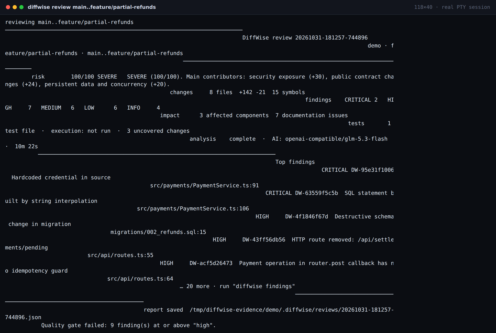

[](https://github.com/hungpt99-dev/DiffWise/actions/workflows/ci.yml)
[](LICENSE)
[](package.json)

---

## The CLI is the product

One command, one report, one exit code. Everything else is a way to read the same report.

| Surface | What it is for | Needs a server | Needs VS Code |
|---|---|---|---|
| `diffwise …` | the review, the report, the gate | no | no |
| `--json` / `--format sarif` | CI, scripts, agents | no | no |
| `diffwise-mcp` | coding agents over stdio | no | no |
| `diffwise report --serve` | a human reading the report in a browser | yes (localhost) | no |
| `diffwise report --format html` | one offline file to attach or archive | no | no |
| VS Code extension | optional, embeds the same report | yes | yes |

DiffWise does not require an editor, and it is not built around one. The VS Code extension is an optional viewer over
the same application services — see [Optional editor integration](#optional-editor-integration).

## The five questions

Answered from repository evidence, not from model prose:

| Question | Where the answer comes from |
|---|---|
| **What changed?** | Real `git diff` parsing: files, hunks, symbols, signature changes, renames, deletions |
| **Why does it matter?** | Per-finding explanation, consequences, and the exact code excerpt that proves it |
| **What could be affected?** | Import/call graph traversal: directly and transitively impacted files, modules, cycles |
| **What might go wrong?** | Deterministic rules (security, concurrency, data, API, reliability) plus an explainable risk score |
| **What is the safest fix?** | Alternative solutions with trade-offs, machine-validated patches, explicit approval, real verification |

## The review pipeline

```
collect → parse → graph → docs & tests → rules (builtin + packs)
        → reviewers (selected, parallel) → correlate → verify → risk → report
```

| Stage | What decides it | What it produces |
|---|---|---|
| Deterministic rules | 32 built-in rules plus installed YAML packs | Findings whose evidence is a real line of code |
| Reviewer selection | Paths, keywords, symbols, graph and risk signals | The smallest set of the 8 reviewers that covers the change (default cap 3) |
| Reviewers | One model call each, independent budgets | Proposals that must survive evidence validation |
| Correlation | File, range, category family, title similarity | Groups rather than duplicates |
| Verification | Deterministic checks + independent verifier opinions | `CONFIRMED` / `LIKELY` / `DISPUTED` / `UNVERIFIED` / `REJECTED` |
| Risk | Additive, attributable factors | Score with every contributing factor and its evidence |
| Approvals | Risk level, policy roles, owner paths | How many humans must approve — a recommendation, never an authorisation |

Consequences worth knowing:

- **No provider needed.** `diffwise review --no-ai` runs the whole pipeline except the model calls. On the demo
  repository that is 25 findings: 7 confirmed from static evidence, 18 likely, 0 rejected.
- **Severity is capped by the verdict.** A `critical` claim supported only by model interpretation ships as `high`
  with the reason attached.
- **A reviewer that fails is reported as failed**, the AI stage is degraded, and the report becomes `partial`.
- **Findings below the published floor are withheld, not deleted.** They stay in the report for audit.

## Everyday commands

```bash
diffwise review                        # working tree, including untracked files
diffwise review --staged               # the index
diffwise review main..HEAD             # a branch
diffwise review --commit HEAD          # one commit
diffwise review src/payments           # just these paths

diffwise findings --severity high      # filter, sort, search
diffwise show DW-63559f5c5b            # evidence, consequences, fix options
diffwise history                       # stored reviews
diffwise compare previous latest       # resolved / introduced / still present
```

Findings are filtered by what was actually proven:

```bash
$ diffwise findings --severity critical
25 findings in review 20261101-095742-89b323 · showing 2

SEVERITY  ID             TITLE                LOCATION
CRITICAL  DW-95e31f1006  Hardcoded credenti…  src/payments/PaymentService.ts:91
CRITICAL  DW-63559f5c5b  SQL statement buil…  src/payments/PaymentService.ts:106
```

| CLI | Web report |
|---|---|
| 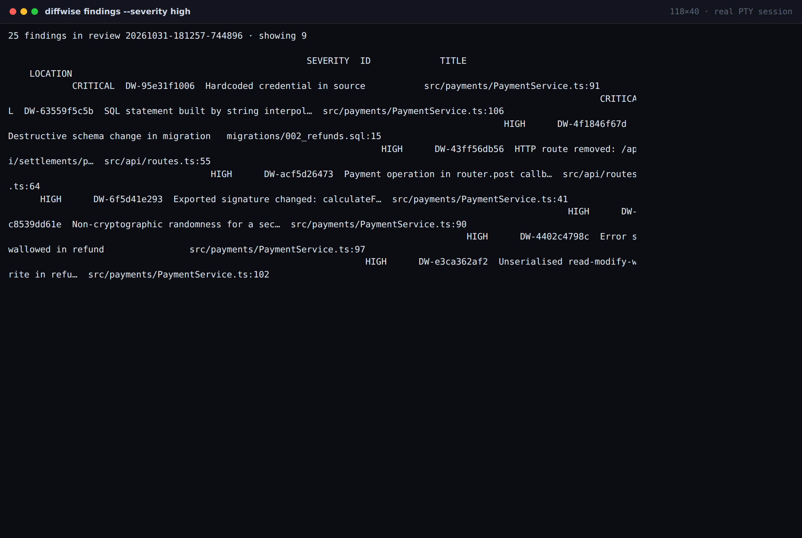 | 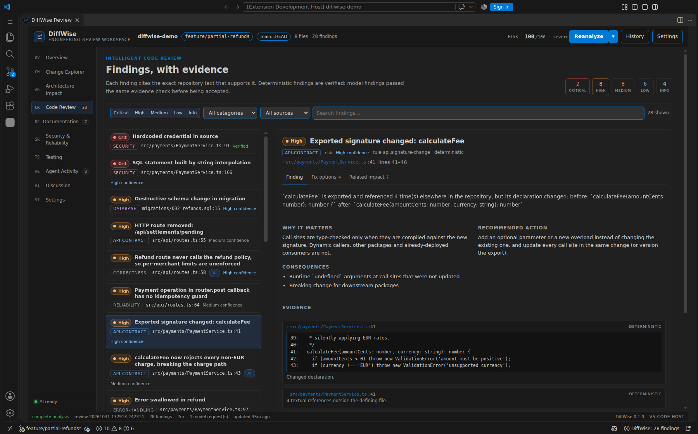 |

## Explain yourself: introspection commands

A review you cannot explain is a review nobody trusts, so the questions a reviewer asks have commands:

```bash
diffwise rules list                      # 32 built-in rules plus installed packs
diffwise rules explain security.sql-injection
diffwise rules validate .diffwise/rules  # every error with the file that caused it
diffwise reviewers plan                  # which reviewers would run, and why the others would not
diffwise policy effective                # every value and the layer that supplied it
diffwise verify                          # run the configured command, record the real result
diffwise evaluate                        # measured quality on the labelled corpus
diffwise doctor                          # git, runtime, config, permissions, provider
```

```
$ diffwise reviewers plan
Correctness reviewer (correctness, score 85)
    - added code changes a branch condition (src/payments/RefundPolicy.ts)
    - risk is severe (100)
    - 142 added line(s), 15 changed symbol(s)
Security reviewer (security, score 198)
    - a SQL string is built by interpolation (src/payments/PaymentService.ts)
    - added code changes an authorization decision (src/payments/RefundPolicy.ts)
    - risk is severe (100)
Architecture reviewer (architecture, score 204)
    - src/api/routes.ts is an API boundary
    - the repository has 1 dependency cycle(s)
not run: database — ranked out: maxReviewers=3 kept 3 reviewer(s)
not run: performance — ranked out: maxReviewers=3 kept 3 reviewer(s)

would run: correctness, security, architecture (cap 3, some reviewers ranked out)
```

Every command works non-interactively — `--json`, stable exit codes, stdout reserved for the result, progress on
stderr — and interactively (`--interactive`, `diffwise chat`) when a real terminal is attached.

## Machine output: CI and agents

```bash
diffwise review main..HEAD --json                              # versioned envelope
diffwise review main..HEAD --format sarif --out diffwise.sarif  # code scanning
diffwise review main..HEAD --fail-on high --no-input            # exit 1 on the gate
```

- Stable exit codes (see [docs/CLI.md](docs/CLI.md#exit-codes)); `1` means the quality gate failed.
- SARIF 2.1.0 with rule metadata, regions and stable fingerprints.
- No prompts, diagnostics on stderr, no optional feature can fail a build.
- `diffwise evaluate` exits `1` if a rule change starts flagging code the corpus marks as safe — a specificity gate
  for rule authors.

```bash
diffwise review --base "origin/${GITHUB_BASE_REF}" --head HEAD \
  --format sarif --out diffwise.sarif --no-input
```

The repository ships a working workflow: [`.github/workflows/diffwise-review.yml`](.github/workflows/diffwise-review.yml).
Guide: [docs/CI_CD.md](docs/CI_CD.md).

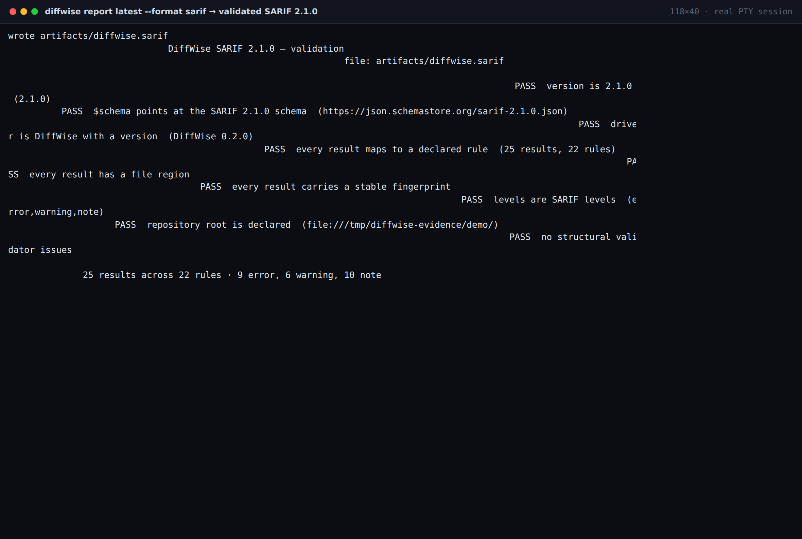

## Coding agents (MCP)

`diffwise-mcp` speaks stdio JSON-RPC and exposes the same services, so an agent can run the full loop:

```
run_review → get_review_findings → get_finding_details → suggest_fixes
           → apply_fix (guarded) → run_verification → get_verification_result → compare_reviews
```

42 tools in two versions. v1 covers the original workflow plus 8 recorders (`record_task_intent`, `record_plan`,
`record_decision`, `record_alternative`, `record_constraint`, `record_activity`, `record_verification`,
`record_unresolved_issue`) that capture structured engineering intent, which the review compares against the actual
diff. v2 adds review status, finding verification, rule/policy introspection, verification plans and human decisions.
Hidden model reasoning is never requested or stored.

```json
{
  "mcpServers": {
    "diffwise": {
      "command": "node",
      "args": ["/absolute/path/to/DiffWise/packages/mcp/bin/diffwise-mcp.js"],
      "env": { "DIFFWISE_REPO_ROOT": "/absolute/path/to/repository" }
    }
  }
}
```

`apply_fix` requires `approved: true` **and** `confirmFindingId === findingId`, so an agent cannot apply a patch it was
not explicitly asked to apply. Every call is audited to `.diffwise/mcp-audit.jsonl` with a hashed argument digest.
See [docs/MCP.md](docs/MCP.md).

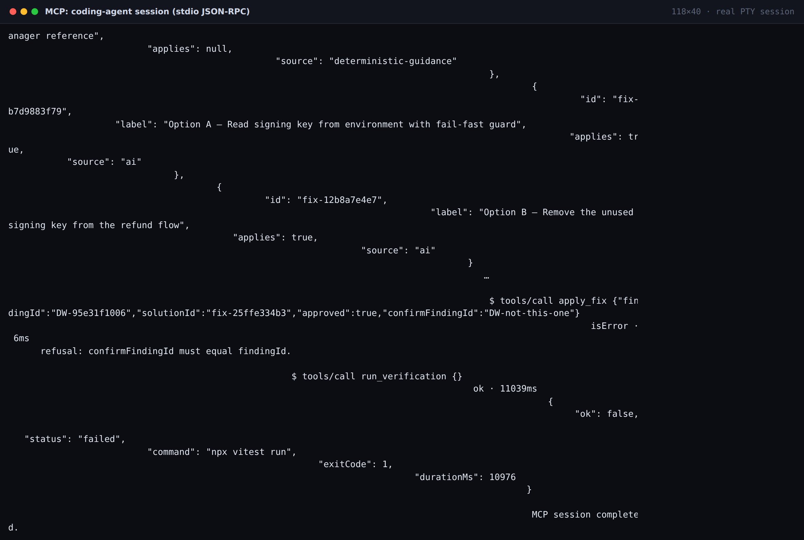

## Reading the report (optional)

The CLI is enough to review a change. When you want to read a report properly — evidence beside the code, filters by
verdict, the pipeline trace — there are two ways, neither of which needs an editor:

```bash
diffwise report latest --serve --open     # localhost only, one-time token
diffwise report latest --format html --out review.html   # one offline file
```

`--serve` starts a loopback-only server with a one-time token. Chat, fix preview/apply and verification need this live
session; the standalone HTML export renders the stored report offline and says which actions are unavailable.

| Overview | Verified findings |
|---|---|
| 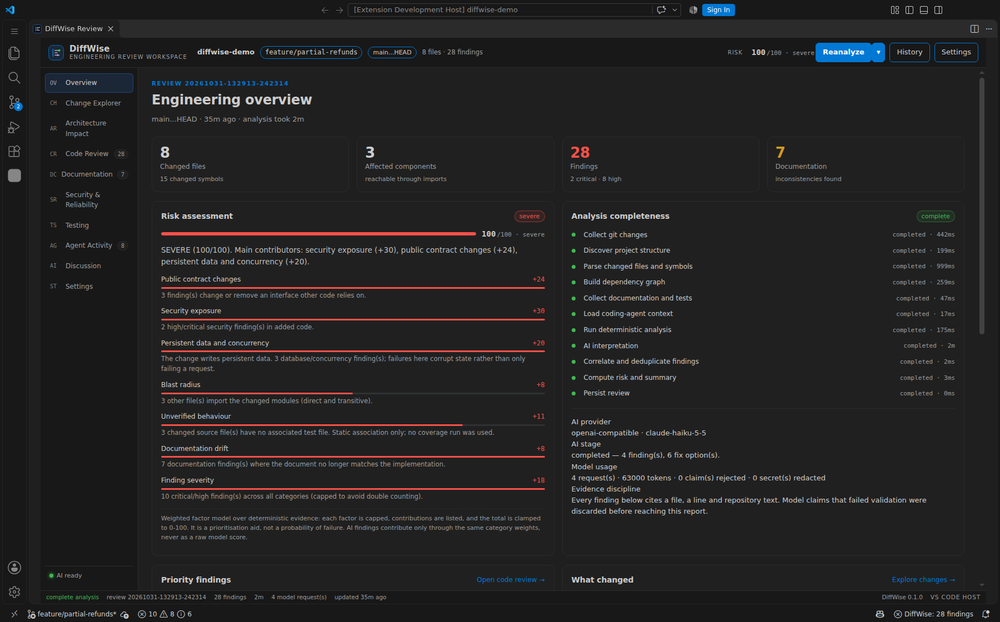 | 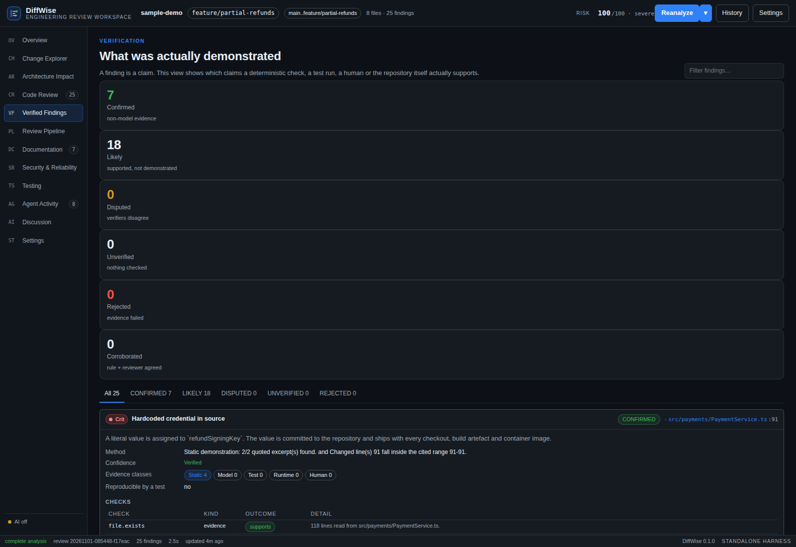 |

| Review pipeline | Architecture impact |
|---|---|
| 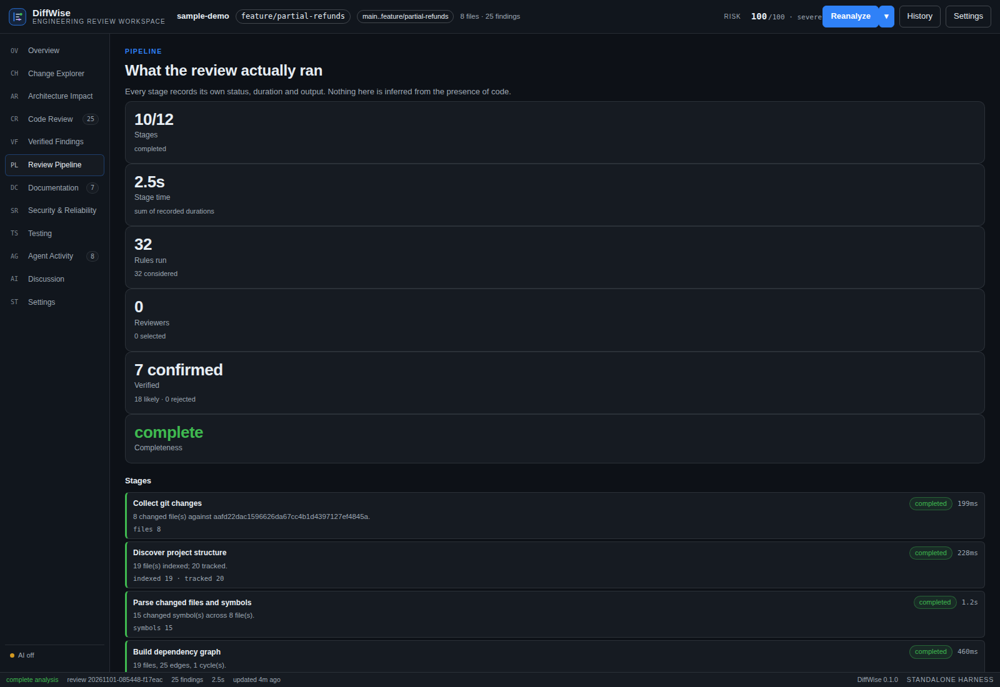 | 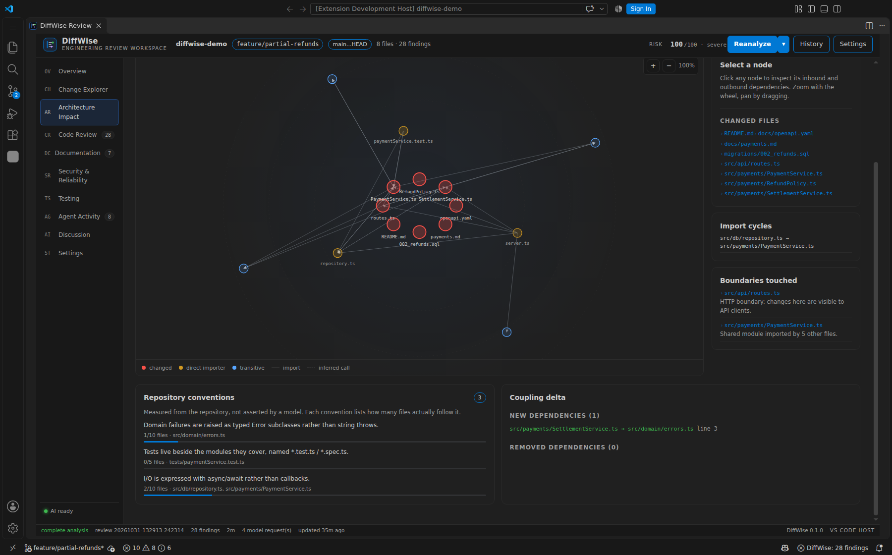 |

| Finding detail | Fix options |
|---|---|
| 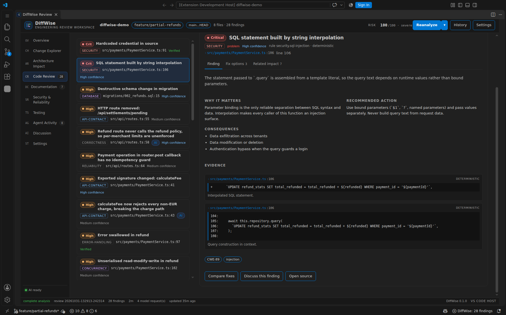 | 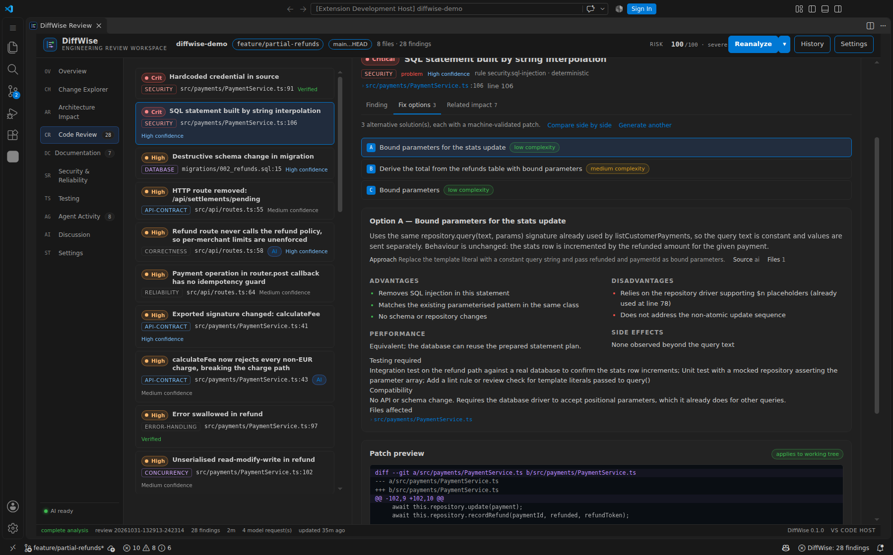 |

| Documentation | Testing |
|---|---|
| 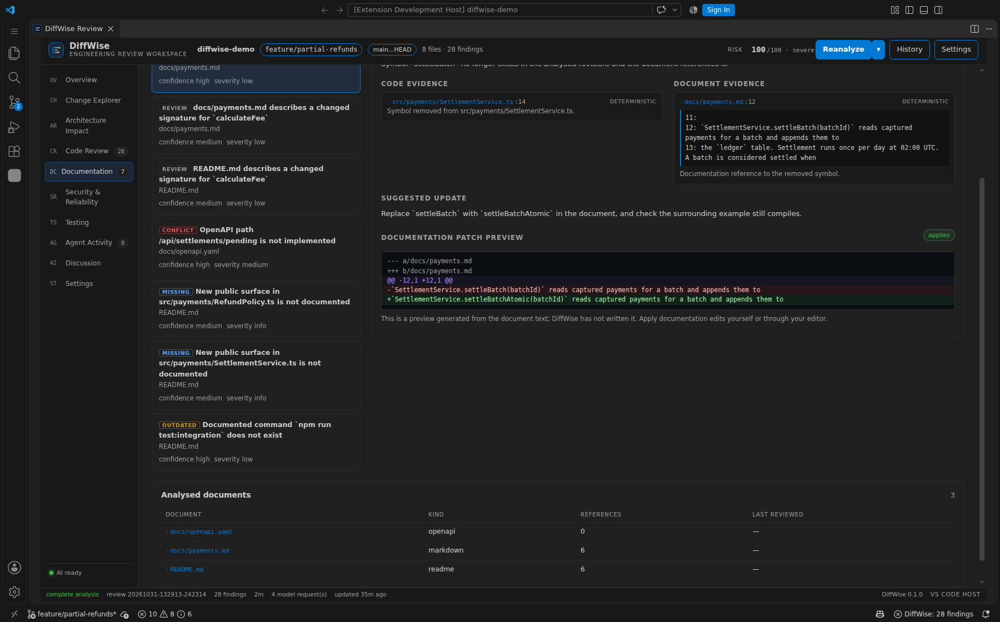 | 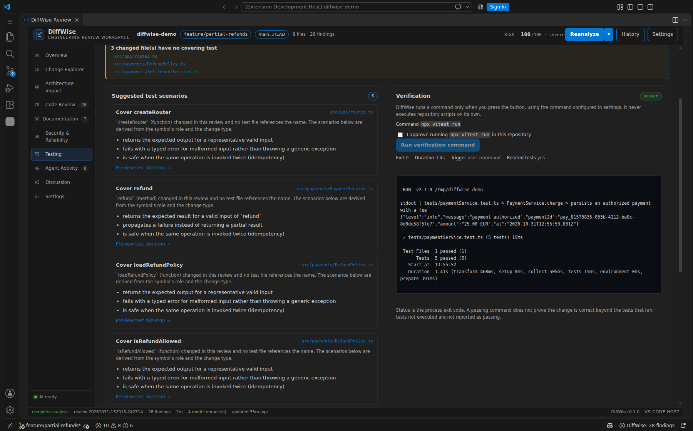 |

Everything on screen is derived from the canonical report: no demo metrics, no placeholder charts. A metric that cannot
be computed is shown as unavailable rather than invented.

## The safe-fix workflow

```
analyse → suggest → compare alternatives → preview patch → explicit approval → apply → verify
```

- Patches are validated against the current files before they are shown, and again immediately before writing.
- File hashes captured at preview time are re-checked at apply time: if you edited the file in between, the apply is
  refused instead of overwriting your work.
- Writes are atomic; every touched file is backed up and recorded in a transaction journal, so rollback is exact.
- `--apply` without `--yes` refuses in non-interactive mode. Nothing is ever written silently.
- Verification runs the command **you** configured, records the real exit code and output, and never reports a fix as
  verified without an execution.

```bash
diffwise fix DW-63559f5c5b --compare          # alternatives with trade-offs
diffwise fix DW-63559f5c5b --preview          # the validated diff, not applied
diffwise fix DW-63559f5c5b --apply --yes      # write it, with a journal entry
diffwise verify --finding DW-63559f5c5b       # the real command, the real exit code
diffwise fix --rollback <applied-fix-id>      # exact restore from the backup
```

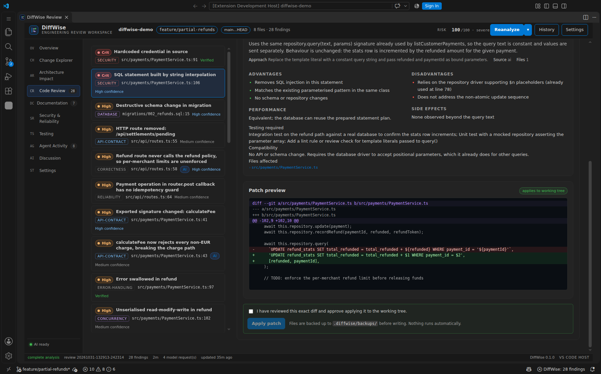

## Configuring the review

All of it is files in `.diffwise/`, so it is reviewable like code:

| File | What it controls | Guide |
|---|---|---|
| `config.json` | provider, analysis limits, verification command, quality gate | [docs/CONFIGURATION.md](docs/CONFIGURATION.md) |
| `policy.json` (+ layer files) | rules, reviewers, verification, risk weights, approvals | [docs/POLICY.md](docs/POLICY.md) |
| `rules/<pack>/` | declarative YAML rules, no recompile | [docs/RULE_PACKS.md](docs/RULE_PACKS.md) |
| `agent-events.jsonl` | recorded intent from a coding agent | [docs/MCP.md](docs/MCP.md) |

```json
{
  "provider": { "id": "openai-compatible", "baseUrl": "https://api.openai.com/v1",
                "model": "gpt-4o-mini", "apiKeyEnvVar": "DIFFWISE_API_KEY" },
  "ai": { "enabled": true, "sendRepositoryContent": false },
  "verification": { "command": "npm test", "timeoutMs": 300000 },
  "qualityGate": { "failOn": "high" }
}
```

Environment overrides (`DIFFWISE_MODEL`, `DIFFWISE_AI=off`, `DIFFWISE_FAIL_ON`, …) are documented in
[docs/CLI.md](docs/CLI.md#environment-variables).

## Measured quality

```bash
npm run eval:build && npm run eval
```

8 labelled fixtures, 13 expected findings, each fixture a real git repository with one defect class:

```
precision 1.0   recall 1.0   f1 1.0   severity 1.0   verification 1.0   forbidden violations 0
```

That number is small and it was refined alongside the tool — [docs/EVALUATION.md](docs/EVALUATION.md) prints the
pre-tuning baseline (`precision 0.438`, `recall 0.875`) and explains exactly what changed: one real false positive
fixed in the N+1 rule, and an incomplete corpus that had not labelled the secondary defects its own fixtures contain.
Read it before quoting the metric.

## Architecture

```
                    Developer / AI agent
                            │
                     diffwise (CLI)          ← the product
                            │
                  @diffwise/app  (application services)
        review · chat · fix · verify · export · server · policy
                            │
                  @diffwise/core (analysis engine)
   git · symbols · graph · rules · verification · policy · risk · store
                            │
        ┌───────────────────┼───────────────────┐
   Report model        AI layer            Patch engine
  (schema v3)      (@diffwise/ai)      (validate/apply)
                            │
   ┌────────────┬───────────┼──────────┬─────────────┐
  JSON       SARIF      MCP server   HTML      report server
 envelope   2.1.0       (stdio)     export     (localhost)
                                                    │
                                            VS Code webview
                                             (optional)
```

- `packages/core` — deterministic engine. No network, no model, no UI.
- `packages/ai` — providers (OpenAI-compatible, Anthropic, Ollama), specialised reviewers, verifiers, chat, fix proposals.
- `packages/app` — the only place a review is run, persisted, discussed or applied. Shared by every surface.
- `packages/cli` — the primary interface: 17 commands, stable exit codes, JSON/SARIF output.
- `packages/mcp` — the same services over stdio for coding agents.
- `packages/webview` — the optional report UI (served locally, exported as HTML, or embedded in VS Code).
- `apps/vscode` — optional extension host. It is the *least* privileged surface and it is not the product.

Details: [docs/ARCHITECTURE.md](docs/ARCHITECTURE.md) · report contract: [docs/REPORT_SCHEMA.md](docs/REPORT_SCHEMA.md).

## What is implemented

| Area | Status | Notes |
|---|---|---|
| CLI (`init` … `evaluate`) | **Implemented** | 17 commands, documented exit codes |
| Canonical report model | **Implemented** | `schemaVersion: 3` with validation + migrations from v1 and v2 |
| JSON envelope (`1.0`) | **Implemented** | Validated in tests and by `tools/evidence/validate-json.mjs` |
| SARIF 2.1.0 | **Implemented** | Structurally validated; GitHub Actions example |
| Deterministic rules | **Implemented** | 32 built-in rules across 6 families |
| Declarative rule packs | **Implemented** | YAML packs, validation, ReDoS screening, `extends`, dependency blocking |
| Review policy | **Implemented** | organization → repository → directory → file, with per-field provenance |
| Specialised reviewers | **Implemented** | 8 specs; deterministic selection, bounded parallel execution, per-reviewer budgets |
| Independent verification | **Implemented** | 5 verdicts, 5 evidence classes, deterministic checks, AI opinions capped at `LIKELY` |
| Risk and approval policy | **Implemented** | Attributable factors, configurable thresholds and approval requirements |
| Human decisions and review state | **Implemented** | Recorded with actor kind; AI can never approve |
| Verification planning | **Implemented** | Command discovery, targeted narrowing, approval gate, sandbox verdict |
| Test execution | **Implemented** | Real command, real exit code; a passing command is never proof |
| Evaluation harness | **Implemented** | 8 labelled fixtures, precision/recall/severity/verification metrics |
| MCP | **Implemented** | 42 tools (19 in interface v1, 23 added in v2), audited |
| Local report server | **Implemented** | Loopback, token session, CSP, CSRF header, workspace boundary |
| Standalone HTML export | **Implemented** | One offline file; live-only actions are labelled |
| AI review, chat, fix generation | **Implemented** | Degrades to deterministic |
| Fix apply + rollback | **Implemented** | Hash-pinned, atomic, journaled, approval-gated |
| CI quality gate | **Implemented** | Configurable severity threshold |
| Web report (12 sections) | **Implemented** | Optional viewer; includes Review Pipeline and Verified Findings |
| VS Code extension | **Optional** | Embeds the same webview; nothing depends on it |
| VS Code Marketplace publishing | **Not planned** | Packaging works locally; no published listing |
| Pull-request ingestion (GitHub/GitLab) | **Not implemented** | Local git targets only; see `docs/INTEGRATIONS.md` |
| Jira / Confluence / CI ingestion | **Not implemented** | Interfaces designed, no adapter |
| External MCP client | **Not implemented** | DiffWise is an MCP server only |
| AI-authored regression tests | **Not implemented** | Reproduction is planned, not generated |
| Sandboxed execution (docker/nsjail) | **Not implemented** | `sandbox` is declared; only `none` has an executor |
| Java/Spring semantic model | **Partial** | Regex-level symbol/route extraction, no bean graph |
| Streaming model responses | **Not supported** | Single-shot requests with hard timeouts |
| Semantic (embedding) retrieval | **Not supported** | Lexical + graph retrieval only, by design |

## Optional editor integration

The VS Code extension bundles the same report UI and adds commands, diagnostics and CodeLens. It is convenient if you
live in an editor and unnecessary otherwise: it calls the same `@diffwise/app` services as the CLI, so it can do
nothing the CLI cannot.

```bash
npm run package:vsix      # apps/vscode/diffwise-0.3.0.vsix
code --install-extension apps/vscode/diffwise-0.3.0.vsix
```

It is not published to a marketplace, and no workflow in this repository requires it.

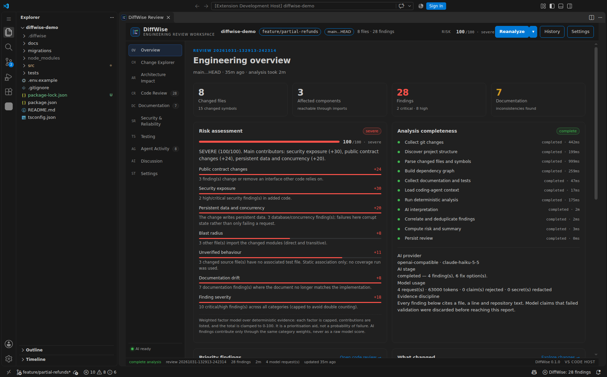

## AI providers

Any OpenAI-compatible endpoint works (OpenAI, Azure-style gateways, Ollama, LM Studio, relays), plus Anthropic's
Messages API. The key is read from an environment variable named in the config — never stored in it, never sent to the
browser.

```bash
export DIFFWISE_API_KEY=…            # or any variable named via provider.apiKeyEnvVar
diffwise config set provider.model gpt-4o-mini
diffwise doctor --connect            # one live request, no review
```

Without a provider, DiffWise still reviews, reports, exports SARIF/HTML and applies human-supplied patches. AI adds
interpretation, chat and generated fixes; it is never required for correctness.

## Security and privacy

- **Local-first.** No telemetry, no cloud service, no account. The report server binds loopback only.
- **What is sent to a model** is bounded and visible: the diff and cited excerpts by default; related repository files
  only with `ai.sendRepositoryContent`. Credentials are redacted before a request.
- **Credentials stay server-side.** The browser never receives a key; the report never contains one.
- **Workspace boundary.** Source reads are limited to files the review references; path traversal is refused.
- **Prompt injection.** Repository text is treated as data; model claims must resolve to real file/line evidence or
  they are discarded and counted.
- **No hidden reasoning.** DiffWise never requests or stores chain-of-thought.

Full model and threat table: [SECURITY.md](SECURITY.md).

## Supported languages

| Language | Symbols | Imports → graph | Notes |
|---|---|---|---|
| TypeScript / JavaScript (incl. TSX) | TypeScript compiler AST | Resolved relative imports, inferred calls | Best coverage |
| Python, Go, Rust, Java, Kotlin, C#, Ruby, PHP | Regex-level extraction | Not resolved | Impact analysis limited to changed files |
| SQL, YAML, JSON, Markdown | Structural / textual | — | Migrations, OpenAPI and docs are analysed as documents |

Known limits are listed in [docs/LIMITATIONS.md](docs/LIMITATIONS.md). DiffWise does not claim semantic equivalence
between regex extraction and a compiler front-end.

## Development

```bash
npm install
npm run build          # core → ai → app → mcp → cli → webview → extension
npm run typecheck
npm test               # 284 tests: unit, integration, CLI end-to-end, MCP over stdio, security
npm run test:e2e       # 25 Playwright checks against the built report UI
npm run eval           # measured quality on the labelled corpus
npm run demo           # materialise the deterministic demo repository
```

The demo fixture (`demo/payments-service`) contains deliberate, realistic defects: an interpolated SQL statement, a
committed signing secret, an irreversible migration, a removed endpoint still documented in OpenAPI, a
read-modify-write refund path, and tests that no longer match a changed signature. It is analysed by the real pipeline.

```bash
node demo/build-demo-repo.mjs --target /tmp/diffwise-demo
cd /tmp/diffwise-demo && node /path/to/DiffWise/packages/cli/bin/diffwise.js review main..feature/partial-refunds --no-ai
```

## Verification and evidence

Claims in this README are backed by artefacts in the repository:

- [docs/QUALITY_CHECKLIST.md](docs/QUALITY_CHECKLIST.md) — every command run, its exit code, and the defects it caught.
- [docs/evidence/baseline.md](docs/evidence/baseline.md) — the pre-work baseline (149 tests) this release started from.
- [docs/evidence/evaluation-run.json](docs/evidence/evaluation-run.json) — the full evaluation report.
- `npm test`, `npm run test:e2e`, `npm run eval` — re-runnable at any time.

## Roadmap

- Pull-request ingestion (GitHub/GitLab) with inline review comments and idempotent webhook processing.
- Jira/Confluence requirement import and CI result ingestion.
- Sandboxed verification execution (docker/nsjail adapters behind the existing interface).
- Java/Spring semantic model (bean graph, `@Transactional` boundaries, Kafka topology).
- Incremental caching keyed by content hash for very large repositories.
- Streaming model responses and per-request cost accounting.

Nothing on this list is claimed as implemented.

## Contributing

See [CONTRIBUTING.md](CONTRIBUTING.md) and [CODE_OF_CONDUCT.md](CODE_OF_CONDUCT.md). Bug reports that include
`diffwise review --json` output (with secrets removed) and `diffwise version` are the easiest to act on.

## License

Apache-2.0 — see [LICENSE](LICENSE).
