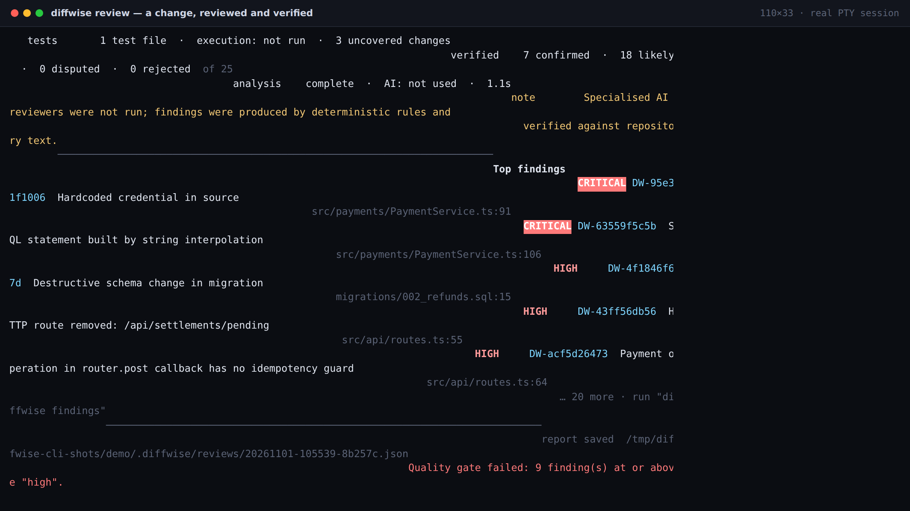

# DiffWise

**Understand every change. Detect hidden risks. Make better engineering decisions.**

DiffWise is an independent, CLI-first engineering review platform. It reads a git change, the architecture around
it, the documentation that describes it and the intent that produced it — then tells you what changed, why it
matters, what could break, and the safest way to fix it.

It is not an IDE plugin with a CLI bolted on. The command line is the product; a rich web report is how humans read
it; MCP is how coding agents call it; SARIF and JSON are how CI consumes it. All four run the same analysis engine and
the same application services.

```bash
git clone https://github.com/hungpt99-dev/DiffWise.git && cd DiffWise
npm install && npm run build && npm link -w @diffwise/cli
diffwise init
diffwise review main..HEAD
diffwise report latest --serve --open
```

[](https://github.com/hungpt99-dev/DiffWise/actions/workflows/ci.yml)
[](LICENSE)
[](package.json)


---

## The five questions

DiffWise answers them from repository evidence, not from model prose:

| Question | Where the answer comes from |
|---|---|
| **What changed?** | Real `git diff` parsing: files, hunks, symbols, signature changes, renames, deletions |
| **Why does it matter?** | Per-finding explanation, consequences and the exact code excerpt that proves it |
| **What could be affected?** | Import/call graph traversal: directly and transitively impacted files, modules, cycles |
| **What might go wrong?** | Deterministic rules (security, concurrency, data, API, reliability) plus an explainable risk score |
| **What is the safest fix?** | Alternative solutions with trade-offs, machine-validated patches, explicit approval, real verification |

## CLI first

```bash
$ diffwise review main..feature/partial-refunds
────────────────────────────────────────────────────────────────────────
DiffWise review 20261031-173530-60d0d5
payments-service · feature/partial-refunds · main..feature/partial-refunds
────────────────────────────────────────────────────────────────────────
risk        100/100 SEVERE   SEVERE (100/100). Main contributors: security exposure (+30), …
changes     8 files  +142 -21  15 symbols
findings    CRITICAL 2   HIGH     7   MEDIUM   6   LOW      6   INFO     4
impact      3 affected components  7 documentation issues
tests       1 test file  ·  execution: not run  ·  3 uncovered changes
analysis    complete  ·  AI: openai-compatible/deepseek-v4.1-flash  ·  1.7s
────────────────────────────────────────────────────────────────────────
Top findings
  CRITICAL DW-63559f5c5b  SQL statement built by string interpolation
            src/payments/PaymentService.ts:106
  …
────────────────────────────────────────────────────────────────────────
report saved  .diffwise/reviews/20261031-173530-60d0d5.json
```



Every command works non-interactively (`--json`, stable exit codes, stdout reserved for the result) and
interactively (`--interactive`, `diffwise chat`) when a real terminal is attached. See
**[docs/CLI.md](docs/CLI.md)** for the full reference.

## The web report

`diffwise report latest --serve` starts a localhost-only server with a one-time token and serves the same React
application the VS Code extension embeds. Chat, fix preview/apply and verification need this live session; the
standalone HTML export (`--format html`) renders the stored report offline and says so.

| Overview | Findings |
|---|---|
|  |  |

| Diff viewer | Architecture impact |
|---|---|
|  |  |

| Documentation | Testing |
|---|---|
|  |  |

| Security & reliability | AI discussion |
|---|---|
|  |  |

| Fix preview | Approval | Verification |
|---|---|---|
|  |  |  |

Everything on screen is derived from the canonical report: no demo metrics, no placeholder charts. A metric that
cannot be computed is shown as unavailable rather than invented. The same report can be exported as one offline HTML
file:


## The safe-fix workflow

```
analyse → suggest → compare alternatives → preview patch → explicit approval → apply → verify
```

- Patches are validated against the current files before they are shown, and again immediately before writing.
- File hashes captured at preview time are re-checked at apply time: if you edited the file in between, the apply is
  refused instead of overwriting your work.
- Writes are atomic; every touched file is backed up and recorded in a transaction journal, so rollback is exact.
- `--apply` without `--yes` refuses in non-interactive mode. Nothing is ever written silently.
- Verification runs the command **you** configured, records the real exit code and output, and never reports a fix
  as verified without an execution.


## Engineering-agent integration (MCP)

`diffwise-mcp` speaks stdio JSON-RPC and exposes the shared services, so an agent can run the full loop:

```
run_review → get_findings → get_finding → suggest_fixes → apply_fix (guarded) → run_verification → run_review → compare_reviews
```

Eight recorders (`record_task_intent`, `record_plan`, `record_decision`, `record_alternative`, `record_constraint`,
`record_activity`, `record_verification`, `record_unresolved_issue`) capture structured engineering intent, which the
review compares against the actual diff. Hidden model reasoning is never requested or stored.

```json
{
  "mcpServers": {
    "diffwise": {
      "command": "node",
      "args": ["/absolute/path/to/DiffWise/packages/mcp/bin/diffwise-mcp.js"],
      "env": { "DIFFWISE_REPO_ROOT": "/absolute/path/to/repository" }
    }
  }
}
```

`apply_fix` requires `approved: true` **and** `confirmFindingId === findingId`, so an agent cannot apply a patch it
was not explicitly asked to apply. See [docs/MCP.md](docs/MCP.md).


## CI and code scanning

```bash
diffwise review --base "origin/${GITHUB_BASE_REF}" --head HEAD \
  --format sarif --out diffwise.sarif --no-input
```

- Stable exit codes (see [docs/CLI.md](docs/CLI.md#exit-codes)); `1` means the quality gate failed.
- `--json` emits a versioned envelope for custom gates.
- SARIF 2.1.0 with rule metadata, regions and stable fingerprints for code scanning.
- No prompts, diagnostics on stderr, no optional feature can fail a build.

The repository ships a working workflow: [`.github/workflows/diffwise-review.yml`](.github/workflows/diffwise-review.yml).


## Architecture

```
                Developer / AI agent
                        │
             ┌──────────┴──────────┐
           CLI                    MCP
             └──────────┬──────────┘
                        │
              @diffwise/app  (application services)
        review · chat · fix · verify · export · server
                        │
              @diffwise/core (analysis engine)
     git · symbols · graph · rules · docs · tests · risk · store
                        │
        ┌───────────────┼────────────────┐
   Report model      AI layer        Patch engine
  (schema v2)     (@diffwise/ai)   (validate/apply)
                        │
        ┌───────────────┼───────────────┬──────────────┐
    Web report      HTML export     JSON envelope   SARIF 2.1.0
```

- `packages/core` — deterministic engine. No network, no model, no UI.
- `packages/ai` — providers (OpenAI-compatible, Anthropic, Ollama), evidence validation, chat, fix proposals.
- `packages/app` — the only place a review is run, persisted, discussed or applied. Shared by CLI, MCP and the web.
- `packages/cli`, `packages/mcp` — thin adapters over `@diffwise/app`.
- `packages/webview` — the report UI (server, standalone export and VS Code webview).
- `apps/vscode` — optional extension host; it is the *least* privileged surface, not the product.

Details: [docs/ARCHITECTURE.md](docs/ARCHITECTURE.md) · report contract: [docs/REPORT_SCHEMA.md](docs/REPORT_SCHEMA.md).

## What is implemented

| Area | Status | Notes |
|---|---|---|
| CLI (`init` … `compare`) | **Implemented** | 12 commands, non-interactive + interactive, documented exit codes |
| Canonical report model | **Implemented** | `schemaVersion: 2` with validation + migrations |
| JSON envelope (`1.0`) | **Implemented** | Validated in tests and by `tools/evidence/validate-json.mjs` |
| SARIF 2.1.0 | **Implemented** | Structurally validated; GitHub Actions example |
| Web report (11 sections) | **Implemented** | Real report data, responsive, dark theme |
| Local report server | **Implemented** | Loopback, token session, CSP, CSRF header, workspace boundary |
| Standalone HTML export | **Implemented** | One offline file; live-only actions are labelled |
| AI review, chat, fix generation | **Implemented** | Verified against a live provider; degrades to deterministic |
| Fix apply + rollback | **Implemented** | Hash-pinned, atomic, journaled, approval-gated |
| Verification | **Implemented** | Real command execution, real exit codes, explicit `not-run` |
| MCP (8 recorders + 7 workflow tools) | **Implemented** | Guarded apply, structured responses |
| CI quality gate | **Implemented** | Configurable severity threshold |
| VS Code extension | **Implemented (optional)** | Embeds the same webview |
| VS Code Marketplace publishing | **Planned** | Packaging works; no published listing |
| Pull-request ingestion (GitHub/GitLab API) | **Not supported** | Local git targets only |
| Java/Spring semantic model | **Partial** | Regex-level symbol/route extraction, no bean graph |
| Streaming model responses | **Not supported** | Single-shot requests with hard timeouts |
| Semantic (embedding) retrieval | **Not supported** | Lexical + graph retrieval only, by design |

## AI providers

Any OpenAI-compatible endpoint works (OpenAI, Azure-style gateways, Ollama, LM Studio, relays), plus Anthropic's
Messages API. The key is read from an environment variable named in the config — never stored in it, never sent to
the browser.

```bash
export DIFFWISE_API_KEY=…            # or any variable named via provider.apiKeyEnvVar
diffwise config set provider.model gpt-4o-mini
diffwise doctor --connect            # one live request, no review
```

Without a provider, DiffWise still reviews, reports, exports SARIF/HTML and applies human-supplied patches. AI adds
interpretation, chat and generated fixes; it is never required for correctness.

## Configuration

`.diffwise/config.json` (created by `diffwise init`):

```json
{
  "provider": { "id": "openai-compatible", "baseUrl": "https://api.openai.com/v1",
                "model": "gpt-4o-mini", "apiKeyEnvVar": "DIFFWISE_API_KEY" },
  "ai": { "enabled": true, "sendRepositoryContent": false },
  "verification": { "command": "npm test", "timeoutMs": 300000 },
  "qualityGate": { "failOn": "high" }
}
```

Environment overrides (`DIFFWISE_MODEL`, `DIFFWISE_AI=off`, `DIFFWISE_FAIL_ON`, …) are documented in
[docs/CLI.md](docs/CLI.md#environment-variables) and [docs/CONFIGURATION.md](docs/CONFIGURATION.md).

## Security and privacy

- **Local-first.** No telemetry, no cloud service, no account. The report server binds loopback only.
- **What is sent to a model** is bounded and visible: the diff and cited excerpts by default; related repository
  files only with `ai.sendRepositoryContent`. Credentials are redacted before a request.
- **Credentials stay server-side.** The browser never receives a key; the report never contains one.
- **Workspace boundary.** Source reads are limited to files the review references; path traversal is refused.
- **Prompt injection.** Repository text is treated as data; model claims must resolve to real file/line evidence or
  they are discarded and counted.
- **No hidden reasoning.** DiffWise never requests or stores chain-of-thought.

Full model: [SECURITY.md](SECURITY.md).

## Supported languages

| Language | Symbols | Imports → graph | Notes |
|---|---|---|---|
| TypeScript / JavaScript (incl. TSX) | TypeScript compiler AST | Resolved relative imports, inferred calls | Best coverage |
| Python, Go, Rust, Java, Kotlin, C#, Ruby, PHP | Regex-level extraction | Not resolved | Impact analysis limited to changed files |
| SQL, YAML, JSON, Markdown | Structural / textual | — | Migrations, OpenAPI and docs are analysed as documents |

Known limits are listed in [docs/LIMITATIONS.md](docs/LIMITATIONS.md). DiffWise does not claim semantic equivalence
between regex extraction and a compiler front-end.

## Development

```bash
npm install
npm run build          # core → ai → app → mcp → cli → webview → extension
npm run typecheck
npm test               # unit, integration, CLI end-to-end, report server and export tests
npm run test:e2e       # Playwright webview harness
npm run demo           # materialise the deterministic demo repository
```

The demo fixture (`demo/payments-service`) contains deliberate, realistic defects: an interpolated SQL statement, a
committed signing secret, an irreversible migration, a removed endpoint still documented in OpenAPI, a
read-modify-write refund path, and tests that no longer match a changed signature. It is analysed by the real
pipeline; the evidence in `docs/evidence/` was produced from it.

```bash
node demo/build-demo-repo.mjs --target /tmp/diffwise-demo
cd /tmp/diffwise-demo && git log --oneline
```

## Verification and evidence

Every claim in this README has a reproducible artefact:

- `docs/evidence/manifest.md` — evidence inventory: command, environment, result, limitations.
- `docs/evidence/logs/` — raw CLI, MCP and server logs from the evidence run.
- `docs/screenshots/` — 20 screenshots from the running product; CLI frames are real PTY transcripts replayed in
  xterm.js, web frames come from the local report server.
- `docs/demos/` — GIFs recorded while driving the real UI.
- `npm test` — unit, integration, CLI end-to-end, report-server and export tests.

```bash
node tools/evidence/capture.mjs      # regenerate screenshots, GIFs and logs
```

## Recorded workflows

| Workflow | Recording |
|---|---|
| CLI review |  |
| Navigating the report |  |
| Architecture impact |  |
| Report-aware chat |  |
| Safe fix |  |

## Roadmap

- Pull-request ingestion (GitHub/GitLab) with inline review comments.
- Java/Spring semantic model (bean graph, `@Transactional` boundaries, Kafka topology).
- Incremental caching keyed by content hash for very large repositories.
- Streaming model responses and per-request cost accounting.
- Additional editors through the same webview (JetBrains, Neovim).

Nothing on this list is claimed as implemented.

## Contributing

See [CONTRIBUTING.md](CONTRIBUTING.md) and [CODE_OF_CONDUCT.md](CODE_OF_CONDUCT.md). Bug reports that include
`diffwise review --json` output (with secrets removed) and `diffwise version` are the easiest to act on.

## License

Apache-2.0 — see [LICENSE](LICENSE).
