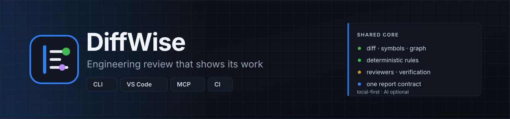
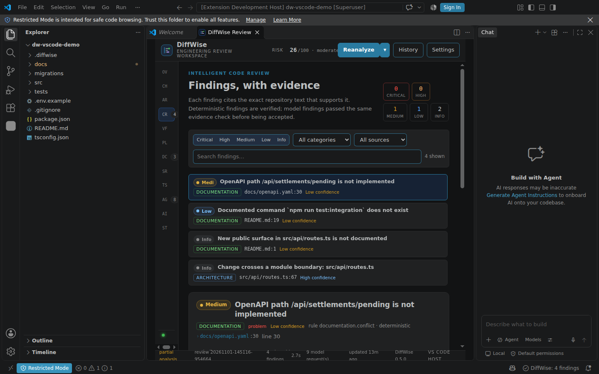
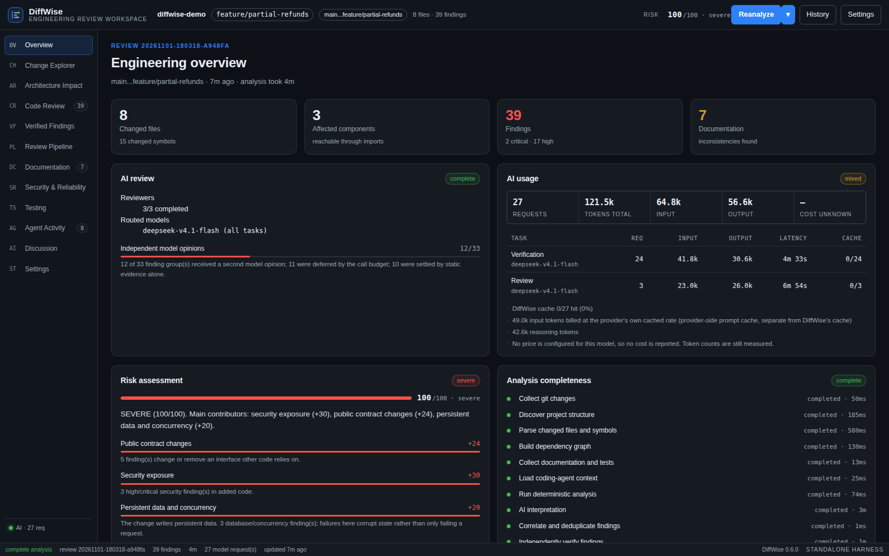
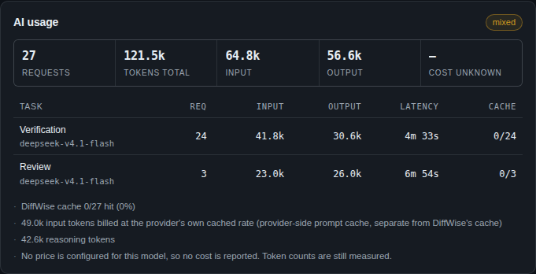
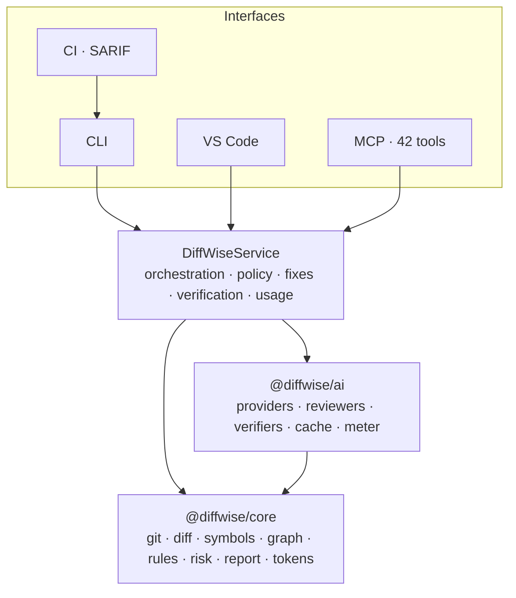

<p align="center">
  <picture>
    <source media="(prefers-color-scheme: light)" srcset="docs/assets/banner-light.svg">
    
  </picture>
</p>

<h1 align="center">DiffWise</h1>

<p align="center">
  <strong>Engineering review that shows its work.</strong><br>
  One local-first review engine for the CLI, VS Code, AI coding agents and CI —
  AI reasons about the change, deterministic analysis supplies the evidence,
  and every finding carries the proof that produced it.
</p>

<p align="center">
  <a href="https://github.com/hungpt99-dev/DiffWise/actions/workflows/ci.yml"></a>
  
  
  
  
  
  
  
</p>

<p align="center">
  <a href="#quick-start">Quick start</a> ·
  <a href="#what-a-review-does">What a review does</a> ·
  <a href="#four-interfaces-one-engine">Interfaces</a> ·
  <a href="#what-a-review-costs">Token cost</a> ·
  <a href="docs/CLI.md">CLI reference</a> ·
  <a href="docs/MCP.md">MCP</a> ·
  <a href="docs/PLATFORM_ARCHITECTURE.md">Architecture</a> ·
  <a href="#status">Status</a> ·
  <a href="CONTRIBUTING.md">Contributing</a>
</p>

---

Most review tooling answers one question: *does this diff look wrong?* That answer is cheap to produce and
expensive to trust. It does not say which caller breaks, which migration cannot be rolled back, which test
should have caught it, whether the finding is real, or what a safe fix costs.

DiffWise closes that loop locally. It reads the actual change — git diff, symbols, imports, the impact graph,
documentation references, tests — runs deterministic rules over it, and only then asks a model to interpret
what a rule cannot. Every finding quotes repository text at a real line, every model claim is validated against
the file it cites, and every verdict names the evidence behind it.

> **AI reasons. Deterministic analysis proves. Evidence required.**

AI is the intelligence layer: it reads the change, the impacted modules, the tests and the intent, and says what could
break and why. Rules and static verification supply the facts it reasons over, and every AI claim is checked against
the file and line it cites before it reaches the report.

AI configuration is required for an AI review, not for the product: with no key the review still runs, still verifies,
and still produces the same report — and it is labelled `AI review unavailable`, never passed off as an AI review that
found nothing. Teams that want the stronger promise set `ai.required: true` (or `--ai-required`), and a review without
a completed AI stage exits `11`.

## Screenshots

<p align="center">
  
  
</p>
<p align="center">
  
  
</p>

<p align="center"><sub>Real output from the demo repository: the CLI, the same review in VS Code, the web report, and its AI-usage panel.</sub></p>

## Quick start

DiffWise is not published to npm or the VS Code Marketplace yet, so it runs from source. No API key needed:

```bash
git clone https://github.com/hungpt99-dev/DiffWise.git && cd DiffWise
npm ci && npm run build

cd /path/to/your/repo
node /path/to/DiffWise/packages/cli/bin/diffwise.js init      # writes .diffwise/config.json
node /path/to/DiffWise/packages/cli/bin/diffwise.js review    # review the working tree
```

Or run it from the checkout with npm scripts:

```bash
npm run cli -- review main..HEAD                      # branch comparison
npm run cli -- review --format json --out review.json # machine output
npm run cli -- review --fail-on high                  # CI gate: exit 1 on findings
npm run cli -- findings --severity high --json        # flat list for scripts
npm run cli -- show DW-63559f5c5b                     # one finding, with evidence
```

Inside VS Code:

```bash
npm run package:vsix
code --install-extension apps/vscode/diffwise-0.6.0.vsix
# then Ctrl+Alt+D, or "DiffWise: Review Current Changes" from the command palette
```

Enabling AI is a configuration change, not a different workflow:

```jsonc
// .diffwise/config.json
{
  "provider": { "id": "openai-compatible", "baseUrl": "https://api.openai.com/v1",
                "model": "gpt-4o-mini", "apiKeyEnvVar": "DIFFWISE_API_KEY" },
  "ai": { "enabled": true, "sendRepositoryContent": false }
}
```

Keys live in environment variables; the config stores only the *name* of the variable and refuses a literal key.

## What a review does

| Stage | What happens | Who decides |
| --- | --- | --- |
| **Collect** | Resolve the target (working tree, staged, branch, commits, paths) and parse the unified diff | git |
| **Understand** | Symbols, signatures, imports, dependency graph, modules, documentation references, tests | TypeScript compiler, resolvers |
| **Detect** | 32 built-in rules across security, concurrency, database, API contract, reliability, resources, tests, plus installed YAML rule packs | Rules |
| **Review** | Specialised reviewers (security, concurrency, database, architecture, performance, correctness, tests, business logic) run in parallel inside a budget | AI, optional |
| **Verify** | Every finding is checked against five evidence classes; model-only opinions are capped and can never confirm a defect alone | Verification engine |
| **Report** | Schema v3 report: risk factors, evidence, completeness, usage, policy state | Engine |
| **Fix** | Alternative patches, validated against the working tree, applied only with explicit approval, journaled for exact revert | You |
| **Prove** | Your configured verification command runs for real; a passing run is never reported as proof that a finding is fixed | Command output |

A finding without evidence is not a finding: structurally invalid claims are counted (`evidenceRejected`) and
never shown as defects. A `critical` claim that nothing could verify ships as `high`, with the reason attached.

## Four interfaces, one engine

| Interface | Role | What it adds |
| --- | --- | --- |
| **CLI** | Execution engine | scripts, CI, machine output, exit codes, `--max-cost` |
| **VS Code** | The product | report panel, tree views, diagnostics, CodeLens, fixes, chat |
| **MCP** | Agent interface | 42 tools: intent, review, findings, evidence, remediation, verification |
| **CI** | Quality gate | SARIF, artefacts, severity thresholds, reproducible runs |

All four call the same `DiffWiseService` and consume the same report contract. That is tested, not asserted:
`packages/mcp/test/interface-parity.test.ts` compares a CLI review and an MCP review of the same commit and requires
identical finding ids, severities, locations, verdicts and risk score. A review started in VS Code is the same
persisted review `diffwise history` lists — the extension contains no pipeline of its own.

## What a review contains

Each finding carries a stable id, category, severity, confidence, kind (`problem`, `risk`, `recommendation`,
`question`), title, description, root cause, exact quoted evidence at a file:line, the consequence, a reproduction
path where one exists, a recommended fix, and a verification verdict.

```text
HIGH  DW-4f1846f67d  Payment operation in router.post callback has no idempotency guard
      src/api/routes.ts:64 · reliability · verified (static + test)
      evidence  src/api/routes.ts:64  "router.post('/api/refunds', refundHandler);"
      why       a retried request creates a second refund row
      fix       2 options, both machine-validated against the working tree
```

## What it finds

| Category | Examples from the corpus |
| --- | --- |
| Security | SQL built by concatenation, hardcoded credentials, missing authorization checks |
| Concurrency | read-modify-write without a lock, lost updates, unsynchronised shared state |
| Database | destructive migrations, missing rollback, transactions spanning an await |
| API contract | removed routes, changed exported signatures under their callers |
| Reliability | retries without idempotency keys, swallowed errors, unbounded queues |
| Performance | N+1 queries, a query per item in a loop |
| Documentation | drift against resolved references: routes, environment variables, commands, symbols |
| Tests | changed files and symbols with no covering test, deleted tests |

On the 8-case labelled corpus the deterministic engine scores 13/13 expected findings, 0 forbidden findings, precision
1.0 — [docs/EVALUATION.md](docs/EVALUATION.md) explains what that does and does not prove.

## What a review costs

Token spend is treated as a product property, not an afterthought:

- **The change is the context.** Diff, changed symbols, deterministic findings and intent go first; code windows,
  callers and tests are added while the budget allows; full related files are opt-in. Budgets are computed in *tokens*
  from the model window, not in characters.
- **Nothing is paid for twice.** Model answers are cached by provider + model + prompt version + the exact prompt, so
  an identical review is free: a recorded rerun went from **62,261 input tokens / 197 s** to **0 tokens / 1.5 s**,
  27/27 cache hits.
- **The numbers are honest.** Every count is labelled `provider-reported` or `estimated`; failed calls are counted; a
  cost appears only when you configure prices, otherwise the report says `cost unknown`.

Measured on the same inputs (`npm run bench`, no model needed):

| Prompt | before | after |
| --- | ---: | ---: |
| Review context at equal budget | 7,969 tokens, 77 % of added lines | 6,769 tokens, **100 %** |
| Reviewer prompt, two ~1,050-line files | 3,568 / 3,257 | **1,275 / 1,275** |
| Fix prompt, three findings | 5,106 | **2,934** |

`diffwise review --max-cost 0.50` turns that into a gate: the run is evaluated, the report is still written, and the
command exits `10` with the measured cost. Without a `pricing` table the flag is refused rather than pretending to
enforce a budget. Details: [docs/TOKEN_EFFICIENCY_AUDIT.md](docs/TOKEN_EFFICIENCY_AUDIT.md) ·
[docs/TOKEN_OPTIMIZATION.md](docs/TOKEN_OPTIMIZATION.md).

## Configuration

Everything is files in `.diffwise/`, reviewable like code:

| File | Controls | Guide |
| --- | --- | --- |
| `config.json` | provider, analysis limits, verification command, quality gate, cache, pricing | [CONFIGURATION.md](docs/CONFIGURATION.md) |
| `policy.json` (+ layers) | rules, reviewers, verification depth, risk weights, approvals | [POLICY.md](docs/POLICY.md) |
| `rules/<pack>/` | declarative YAML rules, no recompile | [RULE_PACKS.md](docs/RULE_PACKS.md) |
| `agent-events.jsonl` | recorded intent from a coding agent | [MCP.md](docs/MCP.md) |

`diffwise config validate` answers "would a review run with this configuration?", with a path for every warning and a
non-zero exit for errors. `diffwise policy effective` shows every value and the layer that supplied it.

## Documentation

| | |
| --- | --- |
| **Using it** | [CLI.md](docs/CLI.md) · [CONFIGURATION.md](docs/CONFIGURATION.md) · [MCP.md](docs/MCP.md) · [TOKEN_OPTIMIZATION.md](docs/TOKEN_OPTIMIZATION.md) |
| **Trusting it** | [VERIFICATION.md](docs/VERIFICATION.md) · [EVALUATION.md](docs/EVALUATION.md) · [LIMITATIONS.md](docs/LIMITATIONS.md) · [SECURITY.md](SECURITY.md) |
| **Building on it** | [PLATFORM_ARCHITECTURE.md](docs/PLATFORM_ARCHITECTURE.md) · [INTERFACE_STRATEGY.md](docs/INTERFACE_STRATEGY.md) · [INTEGRATION_MATRIX.md](docs/INTEGRATION_MATRIX.md) · [REPORT_SCHEMA.md](docs/REPORT_SCHEMA.md) · [RULE_PACKS.md](docs/RULE_PACKS.md) |
| **Operating it** | [CI_CD.md](docs/CI_CD.md) · [INTEGRATIONS.md](docs/INTEGRATIONS.md) · [MIGRATION.md](docs/MIGRATION.md) · [QUALITY_CHECKLIST.md](docs/QUALITY_CHECKLIST.md) |

## Architecture



`core` never imports `ai`; the AI stage is a tracked stage with an explicit status (`complete`, `partial`,
`unavailable`, `disabled`, `failed`) that the report carries. AI is not required to install or open the product, and it
is required for an AI review — which the report states rather than implies. `app` is the only place a review
is run, persisted, discussed or applied. Interfaces add formatting, transport and editor integration — never analysis.
Boundaries and dependency rules: [docs/PLATFORM_ARCHITECTURE.md](docs/PLATFORM_ARCHITECTURE.md).

## Status

Honest, by area. "Implemented" means exercised by a test or a recorded run.

| Area | State |
| --- | --- |
| Git targets, diff parsing, symbols, impact graph, risk, documentation and test analysis | **Implemented** |
| 32 deterministic rules, rule packs, policy layering, approvals, review state | **Implemented** |
| Reviewers, independent verification, evidence validation | **Implemented** |
| Fix options, patch validation, approval, apply, journaled revert | **Implemented** |
| Report schema v3 with v1/v2 migration, SARIF, JSON envelope | **Implemented** |
| CLI (17 commands), MCP (42 tools), web report (12 sections), VS Code extension | **Implemented** |
| Token budgeting, change-first context, answer cache, per-task cost reporting | **Implemented** |
| CI quality gate, GitHub Actions and GitLab CI templates | **Implemented** — the GitLab template has not run on a real runner |
| Incremental review (reuse of analysis for unchanged files) | **Not implemented** — model answers are cached, analysis is re-run |
| Pull-request ingestion, inline review comments, Jira/Confluence import | **Not implemented** — CI publishes SARIF and artefacts |
| Analysis beyond TS/JS (Python, Java, Go, Kotlin, Rust, C#, Ruby, PHP) | **Partial** — regex symbol extraction, no import graph |
| Marketplace / npm distribution | **Not published** — the VSIX builds locally |
| Sandboxed verification (docker/nsjail) | **Declared only** — only `none` has an executor |
| Semantic/embedding retrieval | **Not supported, by design** — lexical and graph retrieval only |

Every line is tracked with evidence in [docs/QUALITY_CHECKLIST.md](docs/QUALITY_CHECKLIST.md); the gaps are in
[docs/LIMITATIONS.md](docs/LIMITATIONS.md).

## Security and privacy

- **Repository content is untrusted data**: fenced, labelled, never followed as instructions.
- **Secrets are redacted** before serialisation, counted, and never written to a report or a log.
- **Local-first**: nothing leaves the machine unless you configure a provider *and* enable `ai.sendRepositoryContent`.
  The report server binds loopback only.
- **Patches are validated** against the current tree, applied only after explicit approval, with a backup and a
  transaction journal so rollback is exact.
- **MCP is audited**: append-only log of hashed arguments; destructive tools require explicit arguments.
- **No hidden reasoning**: chain-of-thought is never requested or stored.

Report a vulnerability per [SECURITY.md](SECURITY.md).

## Supported languages

| Language | Symbols | Imports → graph | Notes |
| --- | --- | --- | --- |
| TypeScript / JavaScript (incl. TSX) | TypeScript compiler AST | Resolved relative imports, inferred calls | Best coverage |
| Python, Go, Rust, Java, Kotlin, C#, Ruby, PHP | Regex-level extraction | Not resolved | Impact analysis limited to changed files |
| SQL, YAML, JSON, Markdown | Structural / textual | — | Migrations, OpenAPI and documentation are analysed as documents |

DiffWise does not claim semantic equivalence between regex extraction and a compiler front-end.

## Development

```bash
npm ci && npm run build      # 7 workspaces
npm test                     # 353 tests, 29 files
npm run typecheck            # 7 workspaces, 0 errors
npm run test:e2e             # 32 webview checks (headless Chromium)
npm run test:e2e:vscode      # 8 checks in a real Extension Development Host (needs a display / Xvfb)
npm run eval                 # labelled corpus: precision, recall, forbidden findings
npm run bench                # token before/after, no model required
npm run package:vsix         # installable extension
```

The demo repository (`demo/payments-service`) contains deliberate, realistic defects — an interpolated SQL statement, a
committed signing secret, an irreversible migration, a removed endpoint still documented in OpenAPI, a read-modify-write
refund path — and is analysed by the real pipeline:

```bash
node demo/build-demo-repo.mjs --target /tmp/diffwise-demo
node packages/cli/bin/diffwise.js review main..feature/partial-refunds --repo /tmp/diffwise-demo --no-ai
```

## Verification and evidence

Claims in this README are backed by artefacts in the repository:

- [docs/QUALITY_CHECKLIST.md](docs/QUALITY_CHECKLIST.md) — every command run, its exit code, and the defects it caught.
- [docs/PRODUCT_AUDIT.md](docs/PRODUCT_AUDIT.md) — the 0.4.0 audit: measured baseline, capability matrix, 12 defects.
- [docs/TOKEN_EFFICIENCY_AUDIT.md](docs/TOKEN_EFFICIENCY_AUDIT.md) and `docs/evidence/token-{bench,calibration}.json` —
  the token numbers quoted above.
- [docs/INTEGRATION_MATRIX.md](docs/INTEGRATION_MATRIX.md) — the cross-interface parity evidence, including a review
  started in VS Code and read by the CLI.
- `docs/evidence/evaluation-run.json` — the full evaluation report.
- `npm test`, `npm run test:e2e`, `npm run eval`, `npm run bench` — re-runnable at any time.

## Roadmap

Next, in order — nothing here is claimed as implemented:

- Approvals and human decisions surfaced in the editor (the engine computes them today).
- A documented editor latency profile (fewer reviewers, shallower verification) for interactive use.
- Incremental review keyed by content hash, invalidated through the impact graph.
- Token and time budgets advertised and enforced per MCP tool.
- GitLab CI verified on a real runner; pull-request inline comments.

See [PRODUCT_ROADMAP.md](docs/PRODUCT_ROADMAP.md) and [MIGRATION_ROADMAP.md](docs/MIGRATION_ROADMAP.md).

## Contributing

See [CONTRIBUTING.md](CONTRIBUTING.md) and [CODE_OF_CONDUCT.md](CODE_OF_CONDUCT.md). The most useful bug report includes
a failing fixture; the second most useful includes `diffwise review --json` output (secrets removed) and
`diffwise version`.

## License

[Apache-2.0](LICENSE).
