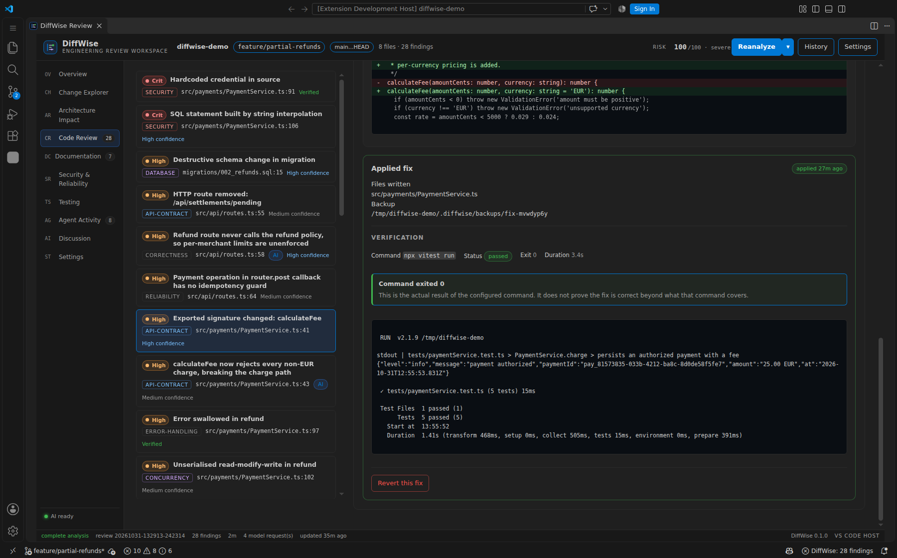
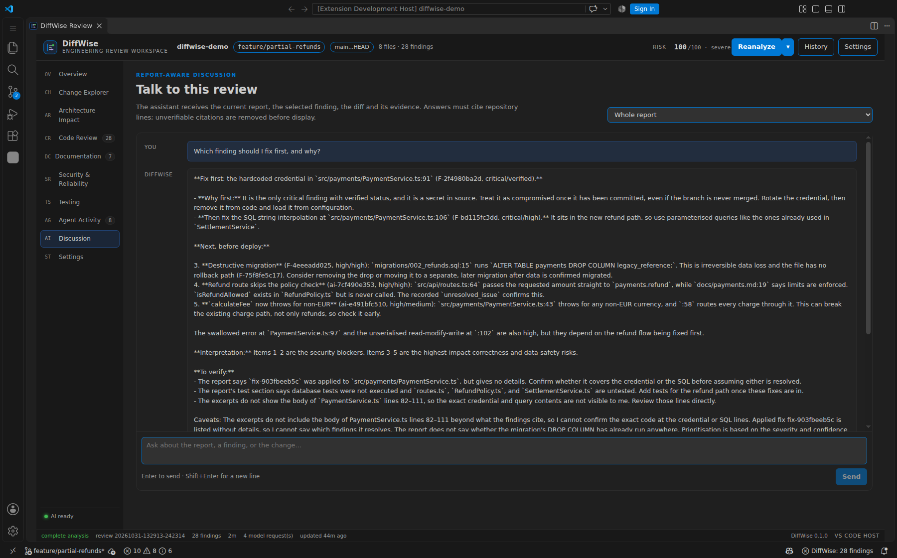
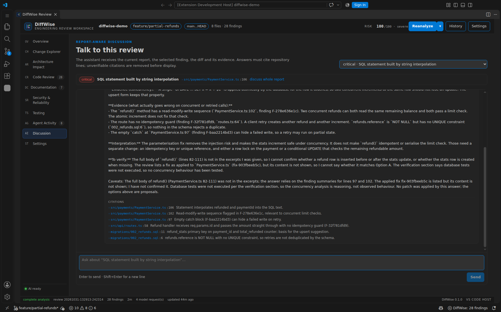
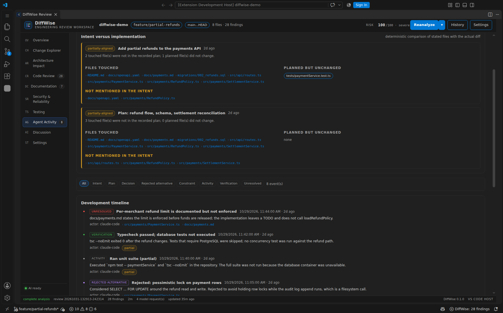
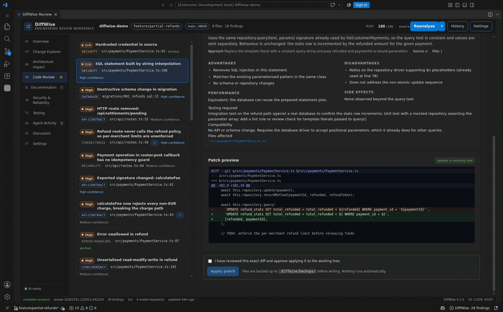
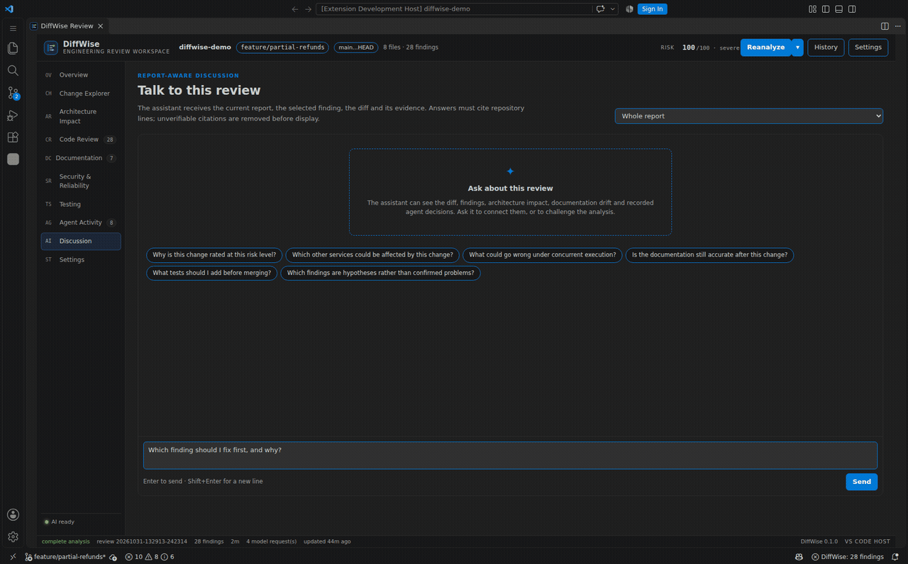
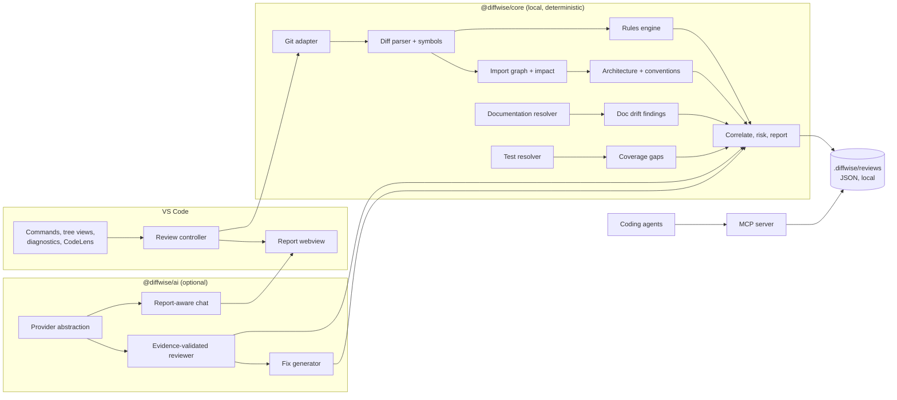

# DiffWise

<p align="center">
  
</p>

<h3 align="center">Understand every change. Make better engineering decisions.</h3>

<p align="center">
  An AI-powered engineering review workspace for Visual Studio Code.<br />
  Read the change, the architecture around it, the documents that describe it and the decisions that produced it —<br />
  then decide what could go wrong and what to do about it.
</p>

<p align="center">
  <a href=".github/workflows/ci.yml"></a>
  
  
  
  
</p>


DiffWise is not a chat box pointed at a diff. It builds a review workspace inside VS Code: a change explorer, an
architecture impact graph, evidence-backed findings, documentation drift detection, alternative fixes with
validated patches, recorded agent intent, and a discussion interface that can only cite lines that exist.

---

## Why DiffWise?

A git diff tells you which lines moved. It does not tell you:

- which services call the function you changed,
- that the OpenAPI document still promises the old signature,
- that the refund path can lose an update under concurrency,
- that the migration cannot be rolled back,
- that the coding agent's own recorded intent said "keep settlement totals correct" while the implementation
  never reconciles them.

DiffWise answers five questions with repository evidence:

| Question | Where the answer comes from |
|---|---|
| What changed? | Git diff, symbol extraction, semantic change groups |
| Why was it changed? | Recorded MCP intent, plans, decisions; commit message as fallback |
| What is affected? | Import graph, reverse reachability, boundary detection |
| What could go wrong? | Deterministic rules + evidence-validated model findings |
| How should it be fixed? | Alternative solutions, trade-offs, validated patches, explicit approval |

Every conclusion carries a file, a line and the repository text that supports it. Model output that cannot be
verified against the repository is discarded before it reaches the report.

---

## See it working

### Engineering overview

Risk is an additive model with named factors — not a black-box score. Analysis completeness is explicit: a failed
stage can never be presented as a complete review.


### Findings with evidence

Deterministic rules and model findings share one evidence contract. Each finding states severity, confidence,
kind (problem / risk / recommendation / question), consequences, reproduction and a concrete recommendation.


### Architecture impact

The graph is built from resolved imports, not guessed. Solid edges are verified imports, dashed edges are inferred
calls, and rings show distance from a changed file. Click a node to inspect inbound and outbound dependencies.


### Documentation intelligence

README, ADRs, OpenAPI and design docs are analysis targets. DiffWise resolves documented references (symbols, paths,
commands, routes, environment variables) against the repository after the change and previews the documentation patch.


### Alternative fixes, validated before you see them

Each solution carries trade-offs, performance notes, side effects, testing requirements and a unified diff that is
machine-validated against the working tree. Nothing is applied without an explicit approval checkbox, and every file
is backed up first.


### Real verification, honestly reported

After a fix is applied, run the configured verification command. DiffWise shows the command, exit code, duration and
the tail of the real output — and states that a passing command does not prove more than it covers.



### Discuss the review, not a generic chatbot

The assistant receives the report, the selected finding, the change and its evidence. Citations are checked against
repository lines; unverifiable ones are removed and counted.




### Coding-agent context

Agents record intent, plans, decisions, rejected alternatives, constraints, activities, verification and unresolved
issues through the MCP server. DiffWise compares stated intent with the actual diff.



### Recorded workflows

| Workflow | Recording |
|---|---|
| Comparing fixes and inspecting a patch |  |
| Asking the report a grounded question |  |

More: [change explorer](docs/screenshots/03-change-explorer.png) ·
[security & reliability](docs/screenshots/08-security-reliability.png) ·
[testing](docs/screenshots/09-testing-analysis.png) ·
[settings](docs/screenshots/16-settings.png) ·
[main workspace](docs/screenshots/01-main-workspace.png)

---

## How it works



The pipeline runs eleven observable stages: collect changes, discover the project, parse symbols, build the graph,
collect documentation and tests, load agent context, run deterministic analysis, run AI interpretation, correlate and
deduplicate, compute risk and summary, persist. Each stage records status, timing and errors; cancellation is
honoured between stages and inside long-running model calls.

Read [docs/ARCHITECTURE.md](docs/ARCHITECTURE.md) for the module boundaries and the decisions behind them.

---

## A review, end to end

The bundled demo is a payments service with one feature commit that introduces partial refunds. It contains realistic
defects on purpose.

```bash
npm install
npm run build
npm run demo                 # materialises /tmp/diffwise-demo with a feature branch
node scripts/analyze.mjs \
  --repo /tmp/diffwise-demo --mode branch --base main --head feature/partial-refunds \
  --out /tmp/diffwise-report.json --no-ai
```

That run produces, on this repository:

| Signal | Result |
|---|---|
| Changed files | 8 |
| Changed symbols | 15 |
| Findings | 24 deterministic (2 critical, 8 high) |
| Documentation inconsistencies | 7 |
| Agent events | 8 (intent, plan, decision, rejected alternative, constraint, activity, verification, unresolved) |
| Risk | severe, every point attributable to a named factor |

With a provider configured, the same run adds evidence-validated model findings and patch proposals. The verified
run used to capture the screenshots completed in **82 seconds**: 28 findings, 4 model-added findings, 8 patches that
apply to the working tree, and a complete (not partial) analysis.

Then open the demo folder in VS Code, press <kbd>Ctrl</kbd>+<kbd>Alt</kbd>+<kbd>D</kbd>, and the same report opens in
the workspace. The **Reanalyze ▾** menu can review the working tree, staged changes, the last commit or a branch.

---

## Safe fix workflow

```
Analyze → Suggest → Compare → Preview → Approve → Apply → Verify
```

1. Pick a finding and open **Fix options**.
2. Compare alternatives side by side (complexity, performance, side effects, compatibility).
3. Inspect the exact unified diff. DiffWise validates it against the current files and reports fuzz.
4. Tick **I have reviewed this exact diff** and press **Apply patch**.
5. Files are backed up to `.diffwise/backups/<id>/` before writing.
6. Run the configured verification command. The result is the real exit code and output.
7. Revert with one click if the result is wrong.

Destructive patches require a second confirmation. DiffWise never applies a patch, runs a command or executes a
repository script without an explicit action.

---

## AI discussion, grounded

The chat is scoped to a report or to a single finding and receives only what the report contains. It is instructed to
separate **Evidence**, **Interpretation** and **To verify**, and to cite `file:line` through structured citations.
On the way out, every citation is resolved against repository content. Invalid citations are dropped, counted and
disclosed as a caveat.

Model claims in the review go through the same discipline: a finding is discarded unless its quoted evidence exists
in the file it names. The report shows how many claim(s) were rejected.

---

## Supported AI providers

DiffWise is provider-independent. One model is used for review, another (optional, faster) for fix generation and chat.

| Provider | Wire format | Notes |
|---|---|---|
| OpenAI-compatible | `/chat/completions` | OpenAI, Azure-compatible gateways, vLLM, LM Studio, OpenRouter, OpenCode Zen/Go, … |
| Anthropic | `/v1/messages` | Native Messages API |
| Ollama / local | OpenAI-compatible `/v1` | No key required; runs entirely locally |
| None | — | Deterministic analysis still runs; AI stages are skipped, not faked |

API keys are read from an environment variable named in settings. They are never written to settings, reports, logs
or screenshots. Every payload is screened for credential patterns and redacted before it leaves the process.

Configuration details and examples: [docs/CONFIGURATION.md](docs/CONFIGURATION.md).

---

## Coding agent integration (MCP)

DiffWise ships a Model Context Protocol server (interface v1) over stdio:

```json
{
  "mcpServers": {
    "diffwise": {
      "command": "node",
      "args": ["/absolute/path/to/DiffWise/packages/mcp/bin/diffwise-mcp.js"],
      "env": { "DIFFWISE_REPO_ROOT": "/absolute/path/to/repository" }
    }
  }
}
```

Tools: `record_task_intent`, `record_plan`, `record_decision`, `record_alternative`, `record_constraint`,
`record_activity`, `record_verification`, `record_unresolved_issue`, `get_change_context`, `get_review_context`,
`get_related_decisions`, `search_project_knowledge`.

The server records only explicit statements the agent chooses to make. It never reads or exposes hidden model
reasoning. See [docs/MCP.md](docs/MCP.md).

---

## Installation

### Requirements

- VS Code 1.90 or newer
- Node.js 20.11 or newer (for development and the CLI)
- Git

### From source (development host)

```bash
git clone https://github.com/hungpt99-dev/DiffWise.git
cd DiffWise
npm install
npm run build

# Launch the Extension Development Host on any repository:
code --extensionDevelopmentPath="$PWD/apps/vscode" /path/to/repository
```

The report panel opens with <kbd>Ctrl</kbd>+<kbd>Alt</kbd>+<kbd>D</kbd> (<kbd>Cmd</kbd>+<kbd>Alt</kbd>+<kbd>D</kbd>
on macOS). The DiffWise activity bar view shows status, findings, changed files and history.

### From the packaged extension

```bash
npm run package:vsix
code --install-extension apps/vscode/diffwise-0.1.0.vsix
```

The VSIX is also produced by the release workflow.

### First review

1. Open a git repository in VS Code.
2. Trust the workspace (VS Code disables extensions in Restricted Mode).
3. Press <kbd>Ctrl</kbd>+<kbd>Alt</kbd>+<kbd>D</kbd>, or run **DiffWise: Review Current Changes**.
4. Deterministic analysis works immediately. To enable AI interpretation, configure a provider (below).

---

## Configuration

The most important settings (full table in [docs/CONFIGURATION.md](docs/CONFIGURATION.md)):

| Setting | Default | Purpose |
|---|---|---|
| `diffwise.provider.id` | `openai-compatible` | Adapter: `openai-compatible`, `anthropic`, `ollama`, `none` |
| `diffwise.provider.baseUrl` | `https://api.openai.com/v1` | Model endpoint |
| `diffwise.provider.model` | `gpt-4o-mini` | Model used for review |
| `diffwise.provider.fastModel` | empty | Optional faster model for fixes and chat |
| `diffwise.provider.apiKeyEnvVar` | `DIFFWISE_API_KEY` | Environment variable holding the key |
| `diffwise.provider.maxTokens` | `4000` | Raise it for reasoning models |
| `diffwise.ai.sendRepositoryContent` | `false` | Send related files, not only the diff |
| `diffwise.verification.command` | empty | Command run only when you approve it |
| `diffwise.analysis.maxFiles` | `200` | Analysis budget per review |

Example: a local model with no data leaving the machine.

```jsonc
{
  "diffwise.provider.id": "ollama",
  "diffwise.provider.baseUrl": "http://127.0.0.1:11434/v1",
  "diffwise.provider.model": "qwen2.5-coder:14b",
  "diffwise.ai.sendRepositoryContent": true
}
```

---

## What is implemented — and what is not

DiffWise is honest about scope. The full matrix with test evidence is in
[docs/QUALITY_CHECKLIST.md](docs/QUALITY_CHECKLIST.md).

**Implemented and verified**

- Git working tree, staged, branch, commit-range and selected-file reviews
- Diff parsing (renames, binary, untracked), symbol extraction, semantic change groups
- Import graph, impact depth, cycles, coupling delta, boundary detection, measured conventions
- 30 deterministic rules across security, concurrency, database, API contract, reliability, quality, architecture
- Documentation impact (README, docs, ADRs, OpenAPI) with patch previews
- Test resolution, coverage gaps, suggested scenarios, real command execution
- Evidence-validated AI findings, alternative fixes with validated patches, apply/revert/verify
- Report-aware and finding-scoped discussion with citation validation
- Local review history, diagnostics, CodeLens, status bar, tree views
- MCP server with 12 tools and a persisted event log
- Unit, integration, browser E2E and VS Code E2E tests; VSIX packaging

**Not implemented (documented, not faked)**

- GitHub/GitLab pull-request and merge-request ingestion
- Jira/Confluence/CI integrations
- Deep AST analysis for languages other than TypeScript/JavaScript (regex-level symbol extraction)
- Vector search / embeddings
- Multi-root workspaces and cross-repository analysis
- Signed marketplace release (the VSIX is built locally)
- Automatic fix application without approval (deliberately out of scope)

See [docs/LIMITATIONS.md](docs/LIMITATIONS.md) for the detail behind each line.

---

## Project structure

```
DiffWise/
├── apps/vscode/          VS Code extension (commands, views, diagnostics, webview host)
├── packages/core/        Deterministic engine: git, diff, symbols, graph, rules, docs, tests, risk, store
├── packages/ai/          Provider adapters, evidence validation, fix generation, report chat
├── packages/mcp/         MCP server (stdio) with structured agent events and knowledge search
├── packages/webview/     React report workspace (Vite), design system, UI E2E
├── demo/                 Reproducible payments-service fixture (base + feature overlays)
├── scripts/analyze.mjs   Headless review runner used by tests and CI
├── e2e/vscode/           Real-workbench E2E over the Chrome DevTools Protocol
├── docs/                 Screenshots, demos, architecture, configuration, quality checklist
└── .github/              CI, release workflow, issue and PR templates
```

---

## Development

```bash
npm install
npm run build            # core, ai, mcp, webview, extension
npm run typecheck        # strict TypeScript across every package
npm test                 # 63 unit + integration tests (builds first)
npm run test:e2e         # 22 browser checks against the production webview build
npm run demo             # materialise the demo repository
npm run package:vsix     # produce apps/vscode/diffwise-0.1.0.vsix
```

The VS Code E2E needs a real Extension Development Host with remote debugging (instructions in
[e2e/vscode/run-vscode-e2e.mjs](e2e/vscode/run-vscode-e2e.mjs)):

```bash
Xvfb :99 -screen 0 1920x1200x24 &
DISPLAY=:99 code --no-sandbox --disable-gpu --user-data-dir=/tmp/dw-vscode \
  --remote-debugging-port=9222 --extensionDevelopmentPath="$PWD/apps/vscode" /tmp/diffwise-demo
node e2e/vscode/run-vscode-e2e.mjs
```

---

## Quality and verification

| Check | Command | Result |
|---|---|---|
| Strict typecheck | `npm run typecheck` | passes for 5 packages |
| Unit + integration | `npm test` | 63 tests passing |
| Webview E2E | `npm run test:e2e` | 22 checks passing |
| VS Code E2E | `node e2e/vscode/run-vscode-e2e.mjs` | 8 checks passing |
| Packaging | `npm run package:vsix` | `diffwise-0.1.0.vsix` (1.73 MB) |

Every screenshot in this README was captured from the running extension host on a virtual display, using a real
repository and a real model endpoint. No mockups. The exact environment and evidence are recorded in
[docs/QUALITY_CHECKLIST.md](docs/QUALITY_CHECKLIST.md).

---

## Roadmap

- Pull-request and merge-request reviews (GitHub, GitLab) with inline comments
- Tree-sitter symbol adapters for Python, Go, Java, Rust
- Semantic retrieval over documentation and decisions (embeddings, local-first)
- Multi-root workspaces and repository-wide architecture views
- CI mode that publishes the report as a build artefact
- Provider capability detection and automatic model routing by task

Priorities are driven by real review workflows, not feature count.

---

## Contributing

Issues and pull requests are welcome. Read [CONTRIBUTING.md](CONTRIBUTING.md) and
[CODE_OF_CONDUCT.md](CODE_OF_CONDUCT.md). Security reports follow [SECURITY.md](SECURITY.md).

## License

Apache-2.0. See [LICENSE](LICENSE).

<p align="center"><em>DiffWise — understand every change.</em></p>
