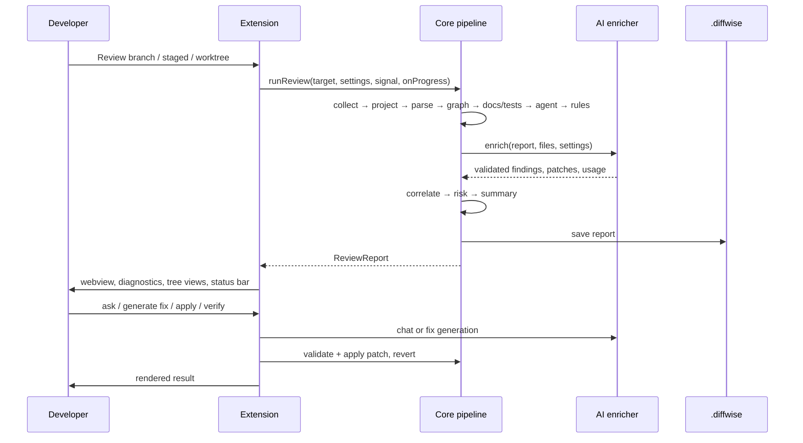

# Architecture

DiffWise is a local-first review workspace. The deterministic engine has no VS Code, network or model dependency; AI
is an optional layer that must prove its claims against repository text. This document explains the module
boundaries and the decisions that shaped them.

## Packages

```
apps/vscode      Extension host: commands, tree views, diagnostics, CodeLens, webview panel, storage
packages/core    Deterministic engine: git, diff, symbols, graph, rules, documentation, tests, risk, patches, store
packages/ai      Provider adapters, context construction, evidence-validated review, fix generation, report chat
packages/mcp     MCP server over stdio: structured agent events, change/review context, knowledge search
packages/webview React report workspace, built with Vite, loaded by the extension inside a webview
```

Dependency direction is strictly one-way:

```
webview  ──types──▶ core
extension ─────────▶ core, ai
ai ────────────────▶ core (types + validation helpers)
mcp ───────────────▶ core
core ──────────────▶ node stdlib + typescript
```

`core` never imports `vscode` or the AI package. `ai` never imports `vscode`. This is what makes the engine testable
headlessly and reusable from CI.

## Data flow



Every stage is wrapped by a tracker that records `pending | running | completed | failed | skipped | cancelled`,
timing, detail and structured metrics. A failed stage forces `summary.completeness = 'partial'`; a stage that
completed with an error (for example findings succeeded but fix generation failed) also forces `partial`. The report
never claims completeness it did not achieve.

## Core engine

| Module | Responsibility | Key decision |
|---|---|---|
| `git/git.ts` | Shell-free git adapter (`execFile`, explicit argv) | Repository-controlled paths can never reach a shell |
| `git/diff.ts` | Unified diff parsing | Handles renames, binary, quoted paths, untracked files |
| `analysis/symbols.ts` | Symbol extraction and symbol-level diffs | TypeScript compiler front-end for JS/TS; regex fallback elsewhere |
| `analysis/graph.ts` | Import graph, impact depth, cycles, coupling delta, conventions | Only resolved imports count as verified edges; inferred calls are labelled |
| `analysis/docAnalysis.ts` | Documentation reference resolution and drift | A finding requires a resolved reference, not a prose opinion |
| `analysis/testAnalysis.ts` | Test discovery, target resolution, coverage gaps | Targets resolved by path, basename and import graph |
| `rules/*.ts` | 30 deterministic rules in six families | Rules only fire on added lines and must attach evidence |
| `analysis/risk.ts` | Additive, capped factor model | Every point is attributable; method is printed with the score |
| `fixes/patch.ts` | Validate/apply/revert unified diffs | Path traversal, context mismatch and deletion are rejected; backup before write |
| `store/store.ts` | JSON review store + append-only agent events | No database server; report files are portable and diff-able |
| `context/contextPack.ts` | Prompt context assembly and secret redaction | Bounded, attributed, fenced as untrusted |

### Why JSON files rather than SQLite

Reviews are documents, not rows. One JSON file per review is inspectable, portable, diff-able and trivially backed
up. The store interface is small (`saveReport`, `loadReport`, `listReviews`, `deleteReport`, `appendAgentEvent`,
`recordAppliedFix`) and a SQLite implementation exists behind the same interface when a repository produces many
reviews.

### Why the TypeScript compiler instead of regex for JS/TS

Symbol granularity, class members, import specifiers and call expressions are exactly what the review needs, and the
TypeScript parser is already a dependency of any TS project. It is also defensive: malformed files return `null`
rather than throwing. The cost is a 9.8 MB extension bundle.

## AI layer

```ts
interface LlmProvider {
  id: string; label: string; model: string;
  capabilities: { chat: boolean; jsonMode: boolean; streaming: boolean; maxContextTokens?: number };
  complete(request: CompletionRequest): Promise<CompletionResult>;
  ping(): Promise<PingResult>;
}
```

Three wire formats are implemented: OpenAI-compatible `/chat/completions`, Anthropic `/v1/messages`, and
Ollama/local `/v1`. Every call has a hard timeout, retries transient failures with exponential backoff, degrades when
`response_format` is rejected, and raises a scrubbed `ProviderError`.

### Evidence validation

A model finding is accepted only when:

1. the named file exists in the repository,
2. the quoted evidence actually appears in that file (whitespace-normalised, single or multi-line), and
3. the finding has a title, a description and a recommendation.

Rejections are counted (`ai.evidenceRejected`) and never presented as findings. Duplicate titles against existing
deterministic findings are suppressed.

### Truncation handling

Reasoning models spend completion tokens on hidden reasoning before content. DiffWise:

1. requests a 12k-token answer,
2. retries once with 24k and a stricter shape when the answer is empty or unparsable,
3. salvages the longest valid JSON prefix (complete findings only), and
4. marks the report `partial` when the answer was truncated, so no one mistakes a recovered subset for a full review.

### Fix generation

Proposals are JSON with a unified diff. Each diff is validated against the working tree before it is shown; a
proposal that does not apply is discarded and counted. Destructive patches (deletions, migrations, workflow files)
are flagged and require a second confirmation.

### Chat

`ReportChat` receives the report, the selected finding, the change, the applied fixes and the conversation history. It
returns structured citations. `validateCitations` resolves every citation against repository content, drops the ones
that do not exist and adds a caveat when any were removed.

## Extension host

| Surface | Behaviour |
|---|---|
| Commands | Review working tree/staged/branch/commits/files, reanalyse, cancel, history, explain, generate fix, discuss, revert, verify, test provider |
| Views | Status, findings (grouped by severity), changed files, review history |
| Diagnostics | One diagnostic per finding, with related evidence locations; cleared on every new report |
| CodeLens | One lens per file with findings, pointing at the highest-severity finding |
| Status bar | Finding count and risk state; click opens the report |
| Panel | Webview with a strict CSP and nonce, `retainContextWhenHidden`, asset URIs rewritten from the Vite build |
| Storage | `.diffwise/reviews`, `.diffwise/agent-events.jsonl`, `.diffwise/applied-fixes.jsonl`, backups |

The webview is a pure view. Every filesystem, git, model and process action happens in the extension host after a
typed message. Unknown message shapes are ignored, arguments are validated, and paths are resolved inside the
workspace.

## Security model

Repository content is untrusted input. The design assumes:

- a file may contain instructions intended to manipulate the model → content is fenced and labelled untrusted; the
  system prompt forbids following it; findings must quote real text;
- a model may invent a path or a line → evidence validation and citation validation reject it;
- a patch may escape the repository → path resolution and `isSafeRelativePath` reject it;
- a command may be suggested by repository content → DiffWise only runs the command configured by the developer, and
  only after explicit approval;
- a secret may sit in the diff → payloads are screened for credential patterns and redacted;
- a report may be shared → keys are never written to reports, settings or logs.

## Performance

- Repository indexing is capped (`analysis.maxFiles`, 4,000 files for the graph) and parallelised with a pool of 12.
- The graph is bounded to 400 impacted nodes and depth 4.
- Prompt context is bounded (16k–60k characters depending on task) and announces truncation.
- Analysis is cancellable between stages and inside model calls.
- The webview never blocks: the extension host runs the pipeline asynchronously and streams stage progress.

## Extensibility

| Extension point | How to add |
|---|---|
| Rule | Implement `Rule` from `packages/core/src/rules/types.ts`, add it to the family export |
| Provider | Implement `LlmProvider` and register it in `createProvider` |
| Documentation format | Extend reference extraction in `docAnalysis.ts` |
| Language | Add an extractor in `symbols.ts` and a test-target resolver |
| MCP tool | Register it in `packages/mcp/src/server.ts` with a zod schema |
| Report section | Add a component under `packages/webview/src/sections` and a rail entry in `protocol.ts` |
